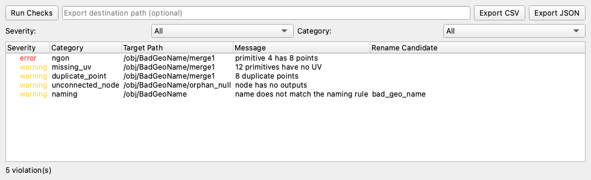

# Scene Doctor

Houdiniシーンのジオメトリ欠陥・ノード構造・命名規則・参照(キャッシュ/HDA)・USDステージを自動検出するツール。

> **English summary**
> Scene Doctor finds problems in Houdini scenes before they reach the render farm: non-manifold/N-gon/zero-area geometry, missing UVs, flipped normals, duplicate points, missing or hard-coded cache paths, outdated HDAs, unconnected nodes, naming-rule violations, and USD (Solaris) stage issues.
> It runs from `hython` (CLI), as an HDA, as a docked PySide6 panel, or in bulk through PDG, and writes CSV / JSON plus a shared "common report" JSON that a publish gate can consume.
> The checks are pure Python behind a ports-and-adapters boundary, so most of the logic is tested without Houdini; the `hou` adapter is verified on a real Houdini 22.0.466 ([record](docs/verification/houdini-22.0.466.md)).
> Install: unzip the release, run `python install_package.py --prefs <Houdini user prefs dir>`, restart Houdini. MIT licensed.



*パネルの表示(本物の PySide6 ウィジェットをヘッドレスで描画したもの。`python scripts/render_panel_screenshot.py` で再生成できる)。*

## 目的・背景

複数アーティストが触るHoudiniシーンは、非多様体ジオメトリ・ゼロ面積ポリゴン・UVの欠落・切れたキャッシュパス・未接続ノード・命名違反が静かに蓄積し、レンダー直前で発覚して手戻りを生む。
Scene Doctorは、これをバッチで自動検出し、レポートにする。

要件定義・設計判断は [docs/要件定義書.md](docs/要件定義書.md) / [docs/仕様書.md](docs/仕様書.md) を参照。

## 検査の一覧

| 種類 | 検査(`check_type`) | 重さ | 内容 |
| --- | --- | --- | --- |
| ジオメトリ | `nonmanifold` | error | 3枚以上が共有するエッジ |
| ジオメトリ | `ngon` | warning | 辺の数が閾値を超えるポリゴン |
| ジオメトリ | `zero_area` | error | 面積がほぼ 0 のポリゴン |
| 品質 | `missing_uv` | warning | UV が無いプリミティブ |
| 品質 | `flipped_normal` | warning | 法線が内向きのプリミティブ(重心基準。4面以上) |
| 品質 | `duplicate_point` | warning | 同じ位置の点 |
| 参照 | `missing_file` | error | 存在しないファイルを指すパラメーター(`$HIP` などを展開して確認) |
| 参照 | `hardcoded_path` | warning | 変数を使わない絶対パス |
| 参照 | `outdated_hda` | warning | 最新ではない版の HDA |
| ノード | `unconnected_node` / `unused_bypassed` | warning | 出力が無いノード / バイパスされたままのノード |
| 命名 | `naming` | warning | 命名規則(YAML)に合わない名前。リネーム候補つき |
| USD | `usd_default_prim` | warning | 既定 Prim が無い、または存在しない Prim を指す |
| USD | `usd_unresolved_reference` | error | 解決できない参照・サブレイヤー |
| USD | `usd_no_material` / `usd_no_uv` | warning | マテリアルのバインドが無い / UV(`st`)が無いメッシュ |

ジオメトリの自動修正はしない。リネーム候補を示すだけに留める([ADR-0003](docs/adr/0003-no-auto-fix.md))。

## 動作環境

| 項目 | 内容 |
| --- | --- |
| Houdini | **22.0.466: 実機で検証済み**(`scripts/verify_houdini.py` の 15 項目、[記録](docs/verification/houdini-22.0.466.md))。22.0.429: 手動で確認([履歴](docs/verification/history-2026-09.md))。19.5〜21.0: 未検証(この環境に無い) |
| Python | 3.11 / 3.12 / 3.13(CI で確認)。Houdini 22 の `hython` は 3.13 |
| OS | macOS: 実機(Houdini)で検証。Linux / macOS / Windows: CI でテストを実行(Houdini なし) |
| 依存 | PyYAML(配布物に同梱)。`--usd` には `usd-core`(任意。Houdini の `hython` では、Houdini 自身の `pxr` を使う) |
| Houdini ライセンス | Steam 版 Houdini Indie は、Steam を起動してから `hython` を使う |

## インストール

### Houdini の package として(利用者向け)

1. [Releases](https://github.com/nokgc333/scene-doctor/releases) から `scene-doctor-<版>.zip` を取得し、好きな場所に展開する(`SHA256SUMS.txt` で確認できる)。
2. 展開したフォルダで、Houdini のユーザー設定フォルダを指定して実行する。標準ライブラリだけで動くので、どの Python 3 でもよい。

   ```bash
   python install_package.py --prefs ~/Library/Preferences/houdini/22.0
   ```

   | OS | ユーザー設定フォルダの例 |
   | --- | --- |
   | macOS | `~/Library/Preferences/houdini/22.0` |
   | Windows | `~/Documents/houdini22.0` |
   | Linux | `~/houdini22.0` |

3. Houdini を再起動する。`$SCENE_DOCTOR_HOME` が設定され、`hython` から `scene_doctor` を import でき、HDA(`Scene Doctor`)が SOP のノードとして現れる。

外すときは、`<ユーザー設定フォルダ>/packages/scene_doctor.json` を消す。

### 開発・テスト用(Houdini 不要)

```bash
python -m venv .venv && source .venv/bin/activate
pip install -e ".[dev]"      # USD の検査も試すなら usd-core も入る
pytest --cov-fail-under=95
```

ロックファイルは `uv.lock`(`uv sync --extra dev`)。

## 使い方

### コマンドライン(`hython`)

```bash
hython scene_doctor_cli.py --hip path/to/scene.hip --format all
```

| オプション | 内容 |
| --- | --- |
| `--hip` / `--usd` / `--lop` | 検査する `.hip` / USD ファイル(Houdini 不要)/ `.hip` の中の LOP ノード(例: `/stage/out`) |
| `--rules` | 命名規則の YAML(既定: `rules/default.yaml`。`--list-rules` で一覧) |
| `--out` / `--format` | 出力先と形式: `csv` / `json` / `common`(共通レポート)/ `both` / `all` |
| `--fail-on` | 終了コード 1 にする重さ: `warning`(既定)/ `error` / `never` |
| `--skip` | 検査の種類を外す: `geometry` / `quality` / `references` / `nodes` / `naming` |
| `--force` | 既存のレポートを上書きする(無いと、終了コード 16) |
| `--redact-home` | レポートのホームフォルダ(利用者名)を `~` にして、共有しやすくする |
| `--quiet` / `--verbose` | 標準出力を抑える / 進捗を標準エラーに出す |

Houdini なしで USD を検査する例と、その出力は [docs/samples](docs/samples) にある。

```bash
python scene_doctor_cli.py --usd docs/samples/broken_asset.usda --format all --redact-home
```

終了コード:

| コード | 意味 |
| --- | --- |
| 0 | 違反なし(`--fail-on` の水準で) |
| 1 | 違反あり |
| 10 | 指定のファイルが無い |
| 11 | 不正なパラメーター(例: geo ノードが無いシーン) |
| 12 | 対象のノードが SOP ネットワークではない |
| 13 | 命名規則のファイルが無い・不正 |
| 14 | レポートを書き込めない |
| 15 | Houdini の `hou` が無い(`hython` で実行する) |
| 16 | レポートが既にある(`--force` で上書き) |

`--format common` は、他のツールが読める共通のレポート(`schema_version` / `tool` / `findings[]`)を出す。スキーマは [docs/schema/common-report.schema.json](docs/schema/common-report.schema.json)。

### HDA

package を入れると、SOP に `Scene Doctor` が現れる。パラメーターで検査の種類・閾値を選び、「Run All Checks」で実行する。結果は `results` に出る。「Export CSV/JSON」で書き出し、「Apply Rename Candidates」で、命名のリネーム候補を適用する。
HDA は、`hda/build_hda.py` で作る(`.hdalc` はバイナリで差分が読めないため、作るスクリプトを正本にする。[ADR-0005](docs/adr/0005-hda-subnet-base.md))。

### PySide6 のパネル

Houdini の Python Shell か shelf tool から起動する。

```python
from scene_doctor.adapters.houdini_panel_launch import launch_panel

panel = launch_panel()
```

「Run Checks」で、違反を一覧にする。行をクリックすると、対象のノードを選択する。severity / category でフィルターでき、CSV / JSON に書き出せる。

> **注意**: `launch_panel()` は、必ず Houdini のメインスレッドから呼ぶ。バックグラウンドのスレッドから呼ぶと、Houdini が固まる(実機で再現済み。外部のプロセスからは `hdefereval.executeInMainThreadWithResult()` を使う)。

### PDG(バッチ)

`pdg/batch_topnet.hip` に、TOPs ネットワークがある。`.hip` を集め、`hython` で `scene_doctor_cli.py` を固定の引数で起動し、個別のレポートを集約する。
cook は、Houdini の UI から手動で実行する([ADR-0006](docs/adr/0006-pdg-manual-cook-only.md))。スクリプトの可読なコピーは `pdg/*_source.py`。

## トラブルシューティング

| 症状 | 原因 | 対処 |
| --- | --- | --- |
| `ModuleNotFoundError: hou` / 終了コード 15 | 普通の Python で実行している | `hython scene_doctor_cli.py ...` で実行する(`--list-rules` と `--usd` は不要) |
| `SCENE_DOCTOR_HOME is not set` | package が登録されていない | 「インストール」の手順 2 を実行し、Houdini を再起動する |
| `hython` で `No module named 'yaml'` | 開発用に、リポジトリをそのまま使っている | リリースの zip を使う(PyYAML 同梱)。開発中は、PyYAML だけを置いたフォルダを `PYTHONPATH` に渡す |
| `--lop` で `UsdTyped has not been created yet` | `PYTHONPATH` の `usd-core` が、Houdini の `pxr` と衝突している | `PYTHONPATH` から `usd-core` を外す(`hython` では、Houdini 自身の `pxr` を使う) |
| `--usd` で `pip install usd-core` と言われる | `pxr` が無い | `pip install usd-core`(Houdini の外で使うとき) |
| 終了コード 16 | 同じ名前のレポートが既にある | `--force`、または `--out` を変える |
| `hython` が、出力のあとも終了しない / `Address already in use` | Houdini の RPC サーバーの既知の挙動(害は無い) | 出力を確認したら、プロセスを止める |
| `hython` がライセンスを取れない | Steam 版 Houdini Indie は、Steam が必要 | Steam を起動してから実行する |
| パネルを出したら Houdini が固まった | メインスレッド以外から Qt を操作した | 上の「注意」を参照 |

## アーキテクチャ(Ports & Adapters)

検査のロジック(`checks/`, `rules.py`, `report.py`, CLI の流れ)は `hou` に依存しない純粋な Python。実 `hou` の呼び出しは、`scene_doctor/adapters/hou_adapter.py` だけに閉じ込める([ADR-0001](docs/adr/0001-ports-and-adapters.md))。これにより、Houdini の無い環境でも、ロジックの大部分を TDD で検証できる。

```
scene_doctor/
├── interfaces.py          # GeometryLike / NodeLike などの Protocol
├── adapters/
│   ├── hou_adapter.py             # 実 hou への依存はここだけ(hython 専用)
│   └── houdini_panel_launch.py    # パネルの実 Houdini へのドッキング
├── checks/
│   ├── geometry.py / quality.py   # 形状 / UV・法線・重複した点
│   ├── references.py              # キャッシュのパス・HDA の版
│   ├── usd_stage.py               # USD ステージ(pxr)
│   ├── nodes.py / naming.py       # ノード構造 / 命名規則
├── hda_support.py / pdg_support.py   # HDA・PDG から呼ぶ、hou に依存しない部分
├── ui/                        # PySide6 のパネル(hou を import しない。ADR-0007)
├── rules.py / report.py       # 命名規則の YAML / CSV・JSON・共通レポート
scene_doctor_cli.py            # hython から起動する CLI
```

## 検証

- 自動テスト: 268 件、カバレッジ 98%(CI の下限は 95%)。Linux / macOS / Windows × Python 3.11〜3.13。静的解析は black / isort / flake8 / mypy(strict)/ pip-audit。
- 実機: `scripts/verify_houdini.py` を `hython` で実行(15 項目、すべて PASS)。記録は [docs/verification](docs/verification/README.md)。
- 規模: 1 万ノード・20 万プリミティブで約 1.2 秒([docs/benchmark.md](docs/benchmark.md))。実シーン(6.3 万プリミティブ、2026-09)でも数秒で完走した。

## 既知の制限事項

- 対象のノードは、`/obj` 配下で表示フラグが立つ最初の geo ノードだけ(単純化した初期の仕様)。複数の geo にまたがる集約は、PDG でファイルごとに行う。
- PDG の cook は、Houdini の UI で手動実行する(自動の E2E 検証はできていない)。
- 実機で検証した Houdini は 22.0 だけ。19.5〜21.0 は未検証(版を足す手順は、[検証の記録](docs/verification/houdini-22.0.466.md))。
- パネルの `hou.ui.curDesktop()` 経由の正式なタブドッキングと、ネットワークエディタのフレーミングは、未確認。

## Design Decisions(ADR)

| ADR | 決めたこと |
| --- | --- |
| [0001](docs/adr/0001-ports-and-adapters.md) | Ports & Adapters で、`hou` への依存を 1 か所に分離する |
| [0002](docs/adr/0002-pdg-for-batch-processing.md) | バッチは PDG(TOPs)で行う |
| [0003](docs/adr/0003-no-auto-fix.md) | 自動修正はせず、リネーム候補の提示に留める |
| [0004](docs/adr/0004-number-not-used.md) | 欠番(使っていない番号の説明) |
| [0005](docs/adr/0005-hda-subnet-base.md) | HDA は subnet ベース(リーフの SOP は HDA にできない) |
| [0006](docs/adr/0006-pdg-manual-cook-only.md) | PDG の cook は手動のみ |
| [0007](docs/adr/0007-pyside6-panel-ports-and-adapters.md) | パネルも Ports & Adapters で分ける |

他の判断: 非多様体は「3 枚以上が共有するエッジ」だけを対象にする(開いた面の境界エッジは正常)。YAML は `yaml.safe_load` だけを使う(SEC-001)。

## セキュリティに関する注意

Scene Doctor は、検証対象の `.hip` を「出所が既知の信頼済みの入力」として扱う。Houdini 自体が、Python ノードや式を含む `.hip` を開いた時点でコードを実行しうるため、出所不明の `.hip` は開かない。
Scene Doctor 自身は、次のことをしない。

- `yaml.safe_load` 以外での YAML 読込
- `exec` / `eval` による動的コード実行、シェルを介したプロセスの起動(CI と `tests/test_code_rules.py` で強制)
- シーンの暗黙の書き換え(`Apply Rename Candidates` 以外)

## 変更履歴

[CHANGELOG.md](CHANGELOG.md)(版は Semantic Versioning。タグ `vX.Y.Z` で、リリース用の zip が GitHub Releases に付く)。

## ライセンス

MIT License([LICENSE](LICENSE)参照)。同梱する PyYAML も MIT(`vendor/LICENSE.PyYAML`)。
