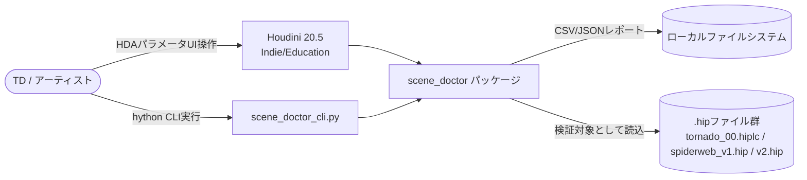
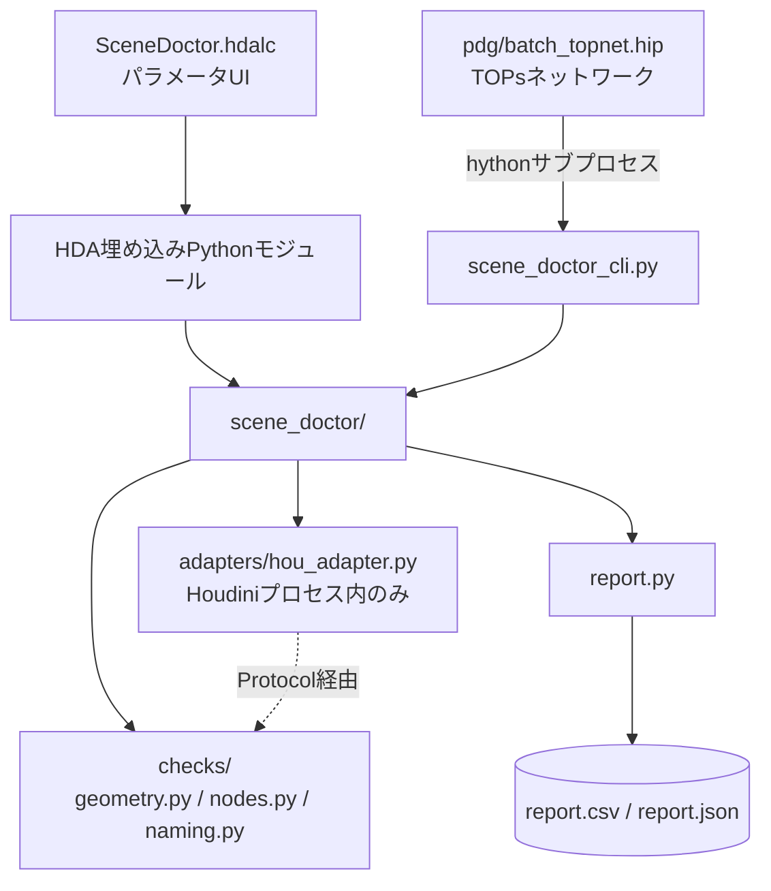
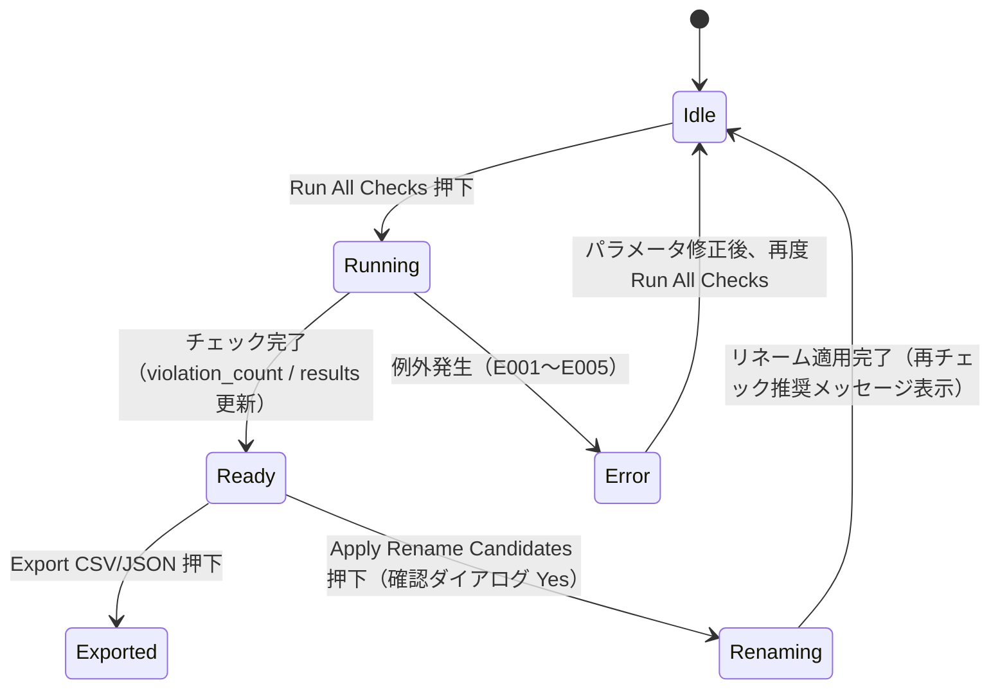

# 仕様書: Houdini Scene Doctor

| 項目 | 値 |
|------|---|
| 版 | 0.1 |
| 作成日 | 2026-09-07 |
| 最終更新 | 2026-09-07 |
| ステータス | ドラフト |
| 著者 | 金子直樹 |
| 関連 | [要件定義書](./要件定義書.md) ／ 姉妹プロジェクト [PipeInit 仕様書 v2](../../../dev/pipeinit/docs/仕様書_v2.md) |

> **セクション読み替えについて**: 本プロジェクトはGUIを持つWeb/モバイルアプリではないため、spec-proドメイン知識の §5 api-spec は「**Python検証モジュールのインターフェース仕様**」、§6 screen-spec は「**HDAパラメータインターフェース仕様**」として読み替える（PipeInitがapi-specをCLIインターフェース仕様に読み替えた前例に倣う）。

---

## 1. quick-reference

| 項目 | 値 |
|------|---|
| リポジトリ | `~/3dcg-dev/scene_doctor`（公開後 `github.com/<user>/scene-doctor`） |
| 実行基盤 | `~/3dcg-dev/houdini_dev`（hrpyc経由でHoudiniをVSCodeから操作する既存環境）を流用 |
| 単一シーン実行（GUI） | Houdini上でSceneDoctor HDAを配置し「Run All Checks」ボタン |
| 単一シーン実行（CLI） | `hython scene_doctor_cli.py --hip <path> --out report.json` |
| バッチ実行（PDG） | Houdini上で`pdg/batch_topnet.hip`を開き対象TOPネットワークをCook |
| テスト実行 | `pytest --cov=scene_doctor -v`（hou非依存部分のみ、Houdini不要） |
| ベンチマーク実行 | `hython tests/benchmark.py`（要件定義書§6.9、Houdini必須） |
| Lint一括 | `black . && isort . && flake8 . && mypy scene_doctor/` |
| CI | `.github/workflows/ci.yml`（push/PR時に自動実行、§11.2） |
| リリース | `git tag v0.1.0 && git push --tags` → GitHub Releases手動作成 |

---

## 2. overview-and-architecture

### 2.1 C4 Context



### 2.2 C4 Container



### 2.3 ADR索引

| ADR | タイトル | ステータス |
|---|---|---|
| ADR-0001 | Ports & Adapters採用によるhouからの検証ロジック分離 | Accepted（本文§14.2） |
| ADR-0002 | バッチ処理にシェル並列ではなくPDG（TOPs）を採用 | Accepted（本文§14.3） |
| ADR-0003 | 自動修正ではなくレポート＋提示に留める設計 | Accepted（本文§14.4） |

### 2.4 障害時の縮退モード

| 障害 | 挙動 |
|---|---|
| PDGバッチ中の1ワークアイテム（hythonサブプロセス）がクラッシュ | 当該ワークアイテムのみ失敗として記録し、他のワークアイテムは継続（SEC-004） |
| 命名規則YAMLが読み込めない | E004で早期終了し、ジオメトリ/ノードチェックは実行しない（命名チェックのみスキップする設計にはしない。理由: 設定ミスを握りつぶさないため） |
| 対象`.hip`が存在しない | E001で早期終了 |

### 2.5 将来の拡張余地

- 自動修正（オートフィックス）機能の追加（現状はレポート＋提示のみ、ADR-0003）
- Houdini以外のDCC対応（Maya/Blender）は本プロジェクトのスコープ外だが、`interfaces.py`のProtocol設計はDCC非依存な形にしてあるため、将来的な拡張の土台にはなり得る

---

## 3. tech-stack-and-repo

### 3.1 pyproject.toml（全文）

```toml
[project]
name = "scene-doctor"
version = "0.1.0"
description = "Houdiniシーンのジオメトリ欠陥・ノード構造・命名規則を自動検出するツール"
readme = "README.md"
requires-python = ">=3.11"
license = { text = "MIT" }
dependencies = [
    "PyYAML>=6.0.2,<7",
]

[project.optional-dependencies]
dev = [
    "pytest>=8.3,<9",
    "pytest-cov>=5.0,<6",
    "black>=24.0",
    "flake8>=7.1",
    "isort>=5.13",
    "mypy>=1.11",
    "pip-audit>=2.7",
    "types-PyYAML",
]

[build-system]
requires = ["setuptools>=68"]
build-backend = "setuptools.build_meta"

[tool.mypy]
strict = true
disallow_untyped_defs = true
warn_unused_ignores = true
# adapters/ は hou スタブが無いため型チェック対象から除外する
exclude = ["scene_doctor/adapters/"]

[tool.black]
line-length = 100

[tool.isort]
profile = "black"

[tool.pytest.ini_options]
addopts = "--cov=scene_doctor --cov-report=term-missing"
testpaths = ["tests"]
```

> 補足: `hou`モジュールはHoudini同梱の環境にしか存在しないため、`pip install -e ".[dev]"`だけではimportできない。CI（GitHub Actions）では`adapters/`を型チェック・実行対象から除外し、`checks/` `report.py` `scene_doctor_cli.py`（の純粋ロジック部分）のみをテストする設計にしている（要件定義書FR-006）。

### 3.2 ディレクトリ構成

```
scene_doctor/
├── scene_doctor/
│   ├── __init__.py
│   ├── interfaces.py       # GeometryLike / NodeLike Protocol定義
│   ├── adapters/
│   │   └── hou_adapter.py  # 実houへの依存はここに閉じ込める
│   ├── checks/
│   │   ├── __init__.py
│   │   ├── geometry.py     # 非多様体・N-gon・ゼロ面積
│   │   ├── naming.py       # 命名規則違反・リネーム候補
│   │   └── nodes.py        # 未接続・未使用ノード
│   ├── rules.py            # 命名規則YAML読込・バリデーション
│   └── report.py           # CSV/JSON出力
├── scene_doctor_cli.py     # hythonから起動するCLIエントリポイント
├── hda/
│   └── SceneDoctor.hdalc
├── pdg/
│   └── batch_topnet.hip
├── rules/
│   └── default.yaml
├── sample_scenes/
│   ├── bad_scene_01.hip     # tornado/spiderweb初期版を素材に流用
│   └── good_scene_01.hip
├── tests/
│   ├── fakes.py             # GeometryLike/NodeLikeの純粋Pythonフェイク
│   ├── fixtures/
│   │   └── large_scene/     # NFR-001計測用フィクスチャ定義
│   ├── test_geometry_checks.py
│   ├── test_node_checks.py
│   ├── test_naming_checks.py
│   ├── test_report.py
│   └── benchmark.py
├── docs/
│   ├── 要件定義書.md
│   ├── 仕様書.md
│   └── adr/
├── .github/workflows/ci.yml
├── pyproject.toml
├── LICENSE
└── README.md
```

### 3.3 環境・ランタイム

| 項目 | 値 |
|---|---|
| Houdini | 20.5 Indie / Education（`~/3dcg-dev/houdini_dev`の既存hrpyc環境を実行基盤として流用。ただしScene Doctor自体はHDA/hythonから直接実行し、hrpycを経由しない） |
| Python（hython同梱） | 3.11系 |
| Python（CI/pytest用venv） | 3.11 / 3.12（PyYAML/pytestのみで完結） |
| 環境数 | `local`のみ（開発・実行を同一マシンで行う個人開発） |

---

## 4. data-design

### 4.1 命名規則ファイルスキーマ

```yaml
# rules/default.yaml
schema_version: 1
project_type: generic
naming_rules:
  - pattern: '^geo_[a-z0-9_]+$'
    applies_to: geo
    description: "Geometryノードはgeo_で始まるsnake_case"
    rename_template: "geo_{seq:03d}"
  - pattern: '^xform_[a-z0-9_]+$'
    applies_to: xform
    description: "Transformノードはxform_で始まるsnake_case"
    rename_template: "xform_{seq:03d}"
  - pattern: '.*'
    applies_to: all
    description: "その他ノード種別は既定では規則を課さない（明示的に緩いルールとして定義）"
```

### 4.2 データ辞書

| キー | 型 | 必須 | 既定値 | 説明 |
|---|---|---|---|---|
| `schema_version` | int | ◯ | - | スキーマの破壊的変更を検知するためのバージョン番号 |
| `project_type` | string | ◯ | - | ルールファイルの識別子（複数スタジオ想定を見据え、PipeInitと同じ設計思想を踏襲） |
| `naming_rules[].pattern` | string(regex) | ◯ | - | Pythonの`re`モジュール互換の正規表現 |
| `naming_rules[].applies_to` | string | ◯ | - | 対象ノードタイプ（`geo` / `xform` / `all`等） |
| `naming_rules[].description` | string | ◯ | - | 違反時にユーザーへ表示する説明文 |
| `naming_rules[].rename_template` | string | - | なし | リネーム候補生成用のフォーマット文字列（`{seq:03d}`等のプレースホルダを使用） |

### 4.3 レポートデータモデル（Pythonデータクラス）

```python
# scene_doctor/report.py（抜粋）
from __future__ import annotations

from dataclasses import dataclass, field
from enum import Enum


class Severity(str, Enum):
    ERROR = "error"
    WARNING = "warning"


@dataclass(frozen=True)
class Violation:
    check_type: str          # "nonmanifold" | "ngon" | "zero_area" | "unconnected_node" | "naming"
    target_path: str         # プリミティブ番号 or ノードパス
    message: str
    severity: Severity
    rename_candidate: str | None = None  # naming違反のみ使用


@dataclass
class SceneReport:
    hip_path: str
    generated_at: str
    violations: list[Violation] = field(default_factory=list)

    @property
    def violation_count(self) -> int:
        return len(self.violations)
```

### 4.4 CSV/JSON出力スキーマ

```json
{
  "$schema": "http://json-schema.org/draft-07/schema#",
  "type": "object",
  "required": ["hip_path", "generated_at", "violation_count", "violations"],
  "properties": {
    "hip_path": { "type": "string" },
    "generated_at": { "type": "string", "format": "date-time" },
    "violation_count": { "type": "integer", "minimum": 0 },
    "violations": {
      "type": "array",
      "items": {
        "type": "object",
        "required": ["check_type", "target_path", "message", "severity"],
        "properties": {
          "check_type": { "type": "string" },
          "target_path": { "type": "string" },
          "message": { "type": "string" },
          "severity": { "type": "string", "enum": ["error", "warning"] },
          "rename_candidate": { "type": ["string", "null"] }
        }
      }
    }
  }
}
```

CSVは`violations`配列をフラット化し、`hip_path` / `check_type` / `target_path` / `message` / `severity` / `rename_candidate`の6列とする（§13.2のTC-024で整合性を検証）。

### 4.5 ID戦略・保持期間・PII分類

該当なし（決済・個人情報を扱わないローカルツールのため、PII分類・保持期間・DBのID戦略は不要）。レポートファイルはユーザー自身のファイルシステム上に生成され、Scene Doctorが保持期間を管理することはない。

---

## 5. Python検証モジュールのインターフェース仕様（api-spec読み替え）

### 5.1 interfaces.py（Protocol定義、全文）

```python
# scene_doctor/interfaces.py
from __future__ import annotations

from typing import Protocol, Sequence


class PrimLike(Protocol):
    def vertex_point_ids(self) -> Sequence[int]:
        """プリミティブを構成する頂点が指す点IDの並び（多角形の周を表す）。"""
        ...

    def measured_area(self) -> float:
        """プリミティブの実測面積。"""
        ...


class GeometryLike(Protocol):
    def prims(self) -> Sequence[PrimLike]:
        """ジオメトリに含まれる全プリミティブ。"""
        ...


class NodeLike(Protocol):
    def path(self) -> str: ...
    def name(self) -> str: ...
    def type_name(self) -> str: ...
    def output_connections(self) -> Sequence["NodeLike"]: ...
    def is_display_flag_set(self) -> bool: ...
    def is_render_flag_set(self) -> bool: ...
    def is_bypassed(self) -> bool: ...
    def children(self) -> Sequence["NodeLike"]: ...
    def set_name(self, new_name: str) -> None: ...
```

### 5.2 checks/geometry.py（関数シグネチャ・実装、全文）

```python
# scene_doctor/checks/geometry.py
from __future__ import annotations

from itertools import combinations

from scene_doctor.interfaces import GeometryLike
from scene_doctor.report import Severity, Violation

DEFAULT_NGON_THRESHOLD = 5
DEFAULT_ZERO_AREA_EPSILON = 1e-6


def check_nonmanifold(geo: GeometryLike) -> list[Violation]:
    """1辺を共有する面の枚数が2以外のエッジを非多様体として検出する。

    エッジは (min(point_a, point_b), max(point_a, point_b)) のタプルで正規化し、
    エッジ -> 隣接プリミティブ数のハッシュマップを構築することで O(総頂点数) で判定する。
    """
    edge_face_count: dict[tuple[int, int], int] = {}
    for prim in geo.prims():
        pts = prim.vertex_point_ids()
        n = len(pts)
        for i in range(n):
            a, b = pts[i], pts[(i + 1) % n]
            edge = (min(a, b), max(a, b))
            edge_face_count[edge] = edge_face_count.get(edge, 0) + 1

    violations: list[Violation] = []
    for edge, count in edge_face_count.items():
        if count != 2:
            violations.append(
                Violation(
                    check_type="nonmanifold",
                    target_path=f"edge{edge}",
                    message=f"edge {edge} is shared by {count} face(s) (expected 2)",
                    severity=Severity.ERROR,
                )
            )
    return violations


def check_ngons(geo: GeometryLike, threshold: int = DEFAULT_NGON_THRESHOLD) -> list[Violation]:
    if threshold < 3:
        raise ValueError("ngon_threshold must be >= 3")
    violations: list[Violation] = []
    for i, prim in enumerate(geo.prims()):
        n = len(prim.vertex_point_ids())
        if n >= threshold:
            violations.append(
                Violation(
                    check_type="ngon",
                    target_path=f"prim{i}",
                    message=f"primitive has {n} sides (threshold={threshold})",
                    severity=Severity.WARNING,
                )
            )
    return violations


def check_zero_area(
    geo: GeometryLike, epsilon: float = DEFAULT_ZERO_AREA_EPSILON
) -> list[Violation]:
    if epsilon <= 0:
        raise ValueError("zero_area_epsilon must be > 0")
    violations: list[Violation] = []
    for i, prim in enumerate(geo.prims()):
        area = prim.measured_area()
        if area < epsilon:
            violations.append(
                Violation(
                    check_type="zero_area",
                    target_path=f"prim{i}",
                    message=f"primitive area {area:.8f} is below epsilon={epsilon}",
                    severity=Severity.ERROR,
                )
            )
    return violations
```

`combinations`はエッジ列挙の別実装候補として import しているが、上記の隣接ペア方式（周を1周する O(n) 走査）を採用し、全頂点対の総当たり（O(n²)）は使用しない設計とした（大規模ポリゴンでのNFR-001対策）。

### 5.3 checks/nodes.py（関数シグネチャ）

```python
# scene_doctor/checks/nodes.py
from __future__ import annotations

from scene_doctor.interfaces import NodeLike
from scene_doctor.report import Severity, Violation


def check_unconnected_nodes(
    network: NodeLike, recurse_into_subnets: bool = True
) -> list[Violation]:
    """出力接続0かつDisplay/Renderフラグが立っていないノードを未接続として検出する。
    バイパス済みノードは check_unused_bypassed_nodes 側で別カテゴリとして扱う。
    """
    ...


def check_unused_bypassed_nodes(
    network: NodeLike, recurse_into_subnets: bool = True
) -> list[Violation]:
    """isBypassed()がTrueのノードを「未使用（バイパス）」として検出する。"""
    ...
```

> 実装本体は要件定義書FR-002のAC（TC-010〜014）を満たすよう、`network.children()`を再帰的に走査し、`output_connections()` / `is_display_flag_set()` / `is_render_flag_set()` / `is_bypassed()`の組み合わせで判定する。コード全文は実装フェーズでリポジトリに反映し、本セクションを実ファイルへのリンクに置き換える（<!-- 要レビュー -->）。

### 5.4 checks/naming.py（関数シグネチャ）

```python
# scene_doctor/checks/naming.py
from __future__ import annotations

import re
from dataclasses import dataclass

from scene_doctor.interfaces import NodeLike
from scene_doctor.report import Severity, Violation


@dataclass(frozen=True)
class NamingRule:
    pattern: re.Pattern[str]
    applies_to: str
    description: str
    rename_template: str | None = None


def check_naming(
    network: NodeLike, rules: list[NamingRule], recurse: bool = True
) -> list[Violation]:
    """命名規則に違反するノードを検出し、rename_templateがあればリネーム候補を付与する。"""
    ...


def generate_rename_candidate(
    node: NodeLike, rule: NamingRule, existing_names: set[str]
) -> str:
    """rename_templateから候補名を生成し、existing_namesと衝突する場合は連番サフィックスで回避する。"""
    ...
```

### 5.5 scene_doctor_cli.py（CLIインターフェース仕様）

```
使い方:
  hython scene_doctor_cli.py --hip <path> [--rules <path>] [--out <path>] [--format {csv,json,both}]

引数:
  --hip     必須。検証対象の.hipファイルパス
  --rules   任意。命名規則YAMLのパス（既定: rules/default.yaml）
  --out     任意。出力先パス（既定: <hipのstem>_report.json / .csv）
  --format  任意。出力形式（既定: both）

終了コード:
  0: 違反0件
  1: 違反N件（N>=1）
  上記以外は §5.6 のエラーコードに対応
```

### 5.6 エラーコード一覧

| code | exit code | 意味 |
|---|---|---|
| E001 | 10 | 対象`.hip`ファイルが存在しない、またはHoudiniで開けない |
| E002 | 11 | 不正なパラメータ値（閾値が範囲外等） |
| E003 | 12 | 指定ノードが期待する種別（SOP/ネットワーク等）でない |
| E004 | 13 | 命名規則YAMLの構文エラー・必須キー欠落 |
| E005 | 14 | 出力先ディレクトリへの書き込み権限がない |

> 0/1は「違反の有無」を表すためCIゲートとして利用しやすいよう予約し、エラー系は10番台に割り当てて明確に区別する。

### 5.7 rules.py（YAML読込・バリデーション実装）

```python
# scene_doctor/rules.py（抜粋）
from __future__ import annotations

import re
from pathlib import Path
from typing import Any

import yaml

from scene_doctor.checks.naming import NamingRule

REQUIRED_KEYS = {"schema_version", "project_type", "naming_rules"}


class RuleFileError(Exception):
    """命名規則YAMLの読込・検証エラー（E004に対応）。"""


def load_naming_rules(path: Path) -> list[NamingRule]:
    try:
        raw: dict[str, Any] = yaml.safe_load(path.read_text(encoding="utf-8"))  # SEC-001
    except yaml.YAMLError as exc:
        raise RuleFileError(f"{path} contains invalid YAML: {exc}") from exc

    if not isinstance(raw, dict):
        raise RuleFileError(f"{path} must be a YAML mapping at the top level")

    missing = REQUIRED_KEYS - raw.keys()
    if missing:
        raise RuleFileError(f"{path} is missing required key(s): {', '.join(sorted(missing))}")

    return [
        NamingRule(
            pattern=re.compile(entry["pattern"]),
            applies_to=entry["applies_to"],
            description=entry["description"],
            rename_template=entry.get("rename_template"),
        )
        for entry in raw["naming_rules"]
    ]
```

---

## 6. HDAパラメータインターフェース仕様（screen-spec読み替え）

### 6.1 HDA概要

| 項目 | 値 |
|---|---|
| アセット名 | `scene_doctor::SceneDoctor::1.0` |
| ファイル | `hda/SceneDoctor.hdalc` |
| ノード種別 | SOP（対象SOPネットワーク上に配置し、配下を検証対象とする） |
| ラベル | Scene Doctor |

### 6.2 パラメータUI構成（フォルダ・項目一覧）

```markdown
### フォルダ: Checks（チェック種別トグル）
| パラメータ名(内部) | ラベル | 型 | 既定値 |
|---|---|---|---|
| enable_geometry | Geometry Checks | Toggle | on |
| enable_nodes | Node Checks | Toggle | on |
| enable_naming | Naming Checks | Toggle | on |

### フォルダ: Thresholds（閾値設定）
| パラメータ名(内部) | ラベル | 型 | 既定値 | 対応FR |
|---|---|---|---|---|
| ngon_threshold | N-gon Threshold | Integer | 5 | FR-001 |
| zero_area_epsilon | Zero-Area Epsilon | Float (log slider) | 0.000001 | FR-001 |
| recurse_subnets | Recurse Into Subnets | Toggle | on | FR-002, FR-003 |

### フォルダ: Naming Rules
| パラメータ名(内部) | ラベル | 型 | 既定値 |
|---|---|---|---|
| rules_path | Naming Rules File | File (読込) | `$HIP/rules/default.yaml` |

### フォルダ: Actions
| パラメータ名(内部) | ラベル | 型 | 動作 |
|---|---|---|---|
| run_checks | Run All Checks | Button | 有効化されたチェックを全て実行し、結果を results に反映 |
| export_report | Export CSV/JSON | Button | 直近の結果を $HIP/report.csv, report.json に出力 |
| apply_rename | Apply Rename Candidates | Button | naming違反のリネーム候補を実際に適用（確認ダイアログ必須、SEC-003/ADR-0003） |

### フォルダ: Results（読み取り専用）
| パラメータ名(内部) | ラベル | 型 |
|---|---|---|
| violation_count | Violation Count | Integer（読み取り専用） |
| results | Results | Multi-line String（読み取り専用、JSON整形テキストを表示） |
```

### 6.3 状態遷移（Actionsボタン起点）



### 6.4 バリデーション・エラー表示

- `ngon_threshold`が3未満の場合、パラメータ欄に赤枠エラー表示（Houdiniのパラメータバリデーション機構、`ngon_threshold >= 3`をPython Verbで検証）。
- `rules_path`が存在しない場合、`Run All Checks`実行時にE004としてポップアップダイアログ（`hou.ui.displayMessage`）で通知する。
- `Apply Rename Candidates`は破壊的操作のため、実行前に必ず`hou.ui.displayConfirmation()`で確認を取る（ADR-0003、要件定義書SEC-003と対応）。

### 6.5 アクセシビリティ・i18n

該当なし（Houdini標準のパラメータUIフレームワークに準拠し、独自のアクセシビリティ実装は行わない。WCAG等の適用外は要件定義書§7の判断に準じる）。

---

## 7. feature-spec

### 7.1 機能 ↔ モジュール ↔ HDAパラメータ ↔ レポート対応表

| FR-ID | 対応モジュール | 対応HDAパラメータ | 対応レポート項目 |
|---|---|---|---|
| FR-001 | `checks/geometry.py` | enable_geometry, ngon_threshold, zero_area_epsilon | check_type = nonmanifold/ngon/zero_area |
| FR-002 | `checks/nodes.py` | enable_nodes, recurse_subnets | check_type = unconnected_node/unused_bypassed |
| FR-003 | `checks/naming.py`, `rules.py` | enable_naming, rules_path, apply_rename | check_type = naming（rename_candidate列を含む） |
| FR-004 | `scene_doctor_cli.py`, `pdg/batch_topnet.hip` | （HDA外、PDGネットワーク側） | 集約report.csv/json |
| FR-005 | `hda/SceneDoctor.hdalc`全体 | - | - |
| FR-006 | `interfaces.py`, `adapters/hou_adapter.py`, `tests/fakes.py` | - | - |

### 7.2 シナリオ（FR-003 命名規則違反の例）

- **Happy**: ユーザーが`Run All Checks`を押下 → naming違反が1件検出され、resultsにリネーム候補が表示される → `Apply Rename Candidates`を押下 → 確認ダイアログでYes → ノード名が変更される → 再度`Run All Checks`で違反0件になることを確認する。
- **Alternative**: リネーム候補が既存の別ノード名と衝突する → 連番サフィックス付き候補（例: `geo_001` → 既存なら`geo_002`）が自動生成される。
- **Error**: `rules_path`が存在しない → E004、ポップアップで通知、チェックは実行されない。

### 7.3 副作用

- `Run All Checks`は読み取り専用（副作用なし）。ただしHDA実行時のみ、naming違反ノードに対し警告色を設定する視覚的フィードバックを行う（要件定義書FR-003 AC-4）。
- `Apply Rename Candidates`のみがシーンを書き換える（ノード名の変更）。この操作はUndo可能（Houdini標準のUndoスタックに乗る）。

### 7.4 冪等性

`Run All Checks`は何度実行しても同じ入力に対し同じ結果を返す（純粋な読み取り）。`scene_doctor_cli.py`によるバッチ実行も同様に、同一`.hip`に対する再実行は同一レポートで上書きする（要件定義書FR-004 AC-3）。

---

## 8. business-logic

### 8.1 非多様体判定アルゴリズム（実装は§5.2に全文掲載）

計算量: プリミティブ総頂点数を`V`とすると、エッジ列挙は`O(V)`、ハッシュマップの走査も`O(V)`のため全体`O(V)`。10万ポリゴン規模（1ポリゴンあたり平均4頂点と仮定して`V≈40万`）でもNFR-001の目標（10秒以内）を満たせる設計とする。

### 8.2 リネーム候補生成アルゴリズム

```python
# scene_doctor/checks/naming.py（generate_rename_candidateの実装イメージ）
def generate_rename_candidate(node, rule, existing_names):
    seq = 1
    while True:
        candidate = rule.rename_template.format(seq=seq)
        if candidate not in existing_names and candidate != node.name():
            return candidate
        seq += 1
```

端数処理等の計算式は本プロジェクトには存在しない（税・割引・ポイント等の業務ロジックはCG制作パイプラインツールという性質上、該当なし）。

### 8.3 面積計算・ゼロ面積判定の閾値設計

```
epsilon既定値 1e-6 の根拠:
  Houdini内部の浮動小数点誤差（float32相当）を考慮し、
  実質的に「面が潰れている」とみなせる下限として1e-6を採用。
  スタジオのスケール単位（cm/m）によって適切な値は変わり得るため、
  HDAパラメータとして可変にしている（§6.2 zero_area_epsilon）。
```

---

## 9. security-implementation

### 9.1〜9.4, 9.6

該当なし（認証・暗号鍵管理・Cookie・個人情報を扱わない）。

### 9.5 payment-pci

該当なし（決済機能を持たない）。

### 9.7 実装対応（要件定義書§12との対応）

| SEC-ID | 実装箇所 | テスト |
|---|---|---|
| SEC-001 | `rules.py: load_naming_rules()` の `yaml.safe_load` | TC-022 |
| SEC-002 | `pdg/batch_topnet.hip`のPython Script TOPは固定スクリプト`scene_doctor_cli.py`のサブプロセス起動のみを行い、動的な文字列を`exec`/`eval`しない（静的レビューで担保） | CI上のgrepチェック（§11.2） |
| SEC-003 | `Apply Rename Candidates`ボタンのみがシーンを書き換え、それ以外の操作は読み取り専用 | TC-016, TC-017（提示のみであることの確認） |
| SEC-004 | `scene_doctor_cli.py`をhythonサブプロセスとして起動することで、1ファイルのクラッシュがPDGネットワーク全体に波及しないようにする | TC-019 |
| SEC-005 | `.github/workflows/ci.yml`の`pip-audit`ステップ | CI自体のgreen判定 |

### 9.8 信頼境界の実装対応

要件定義書§12.2で定義した信頼境界の考え方を踏まえ、README（Design Decisions節）に以下を明記する。

```markdown
## セキュリティに関する注意
Scene Doctorは検証対象の.hipファイルを「出所が既知の信頼済み入力」として扱います。
Houdini自体がPythonノードや式を含む.hipファイルを開いた時点でコードを実行しうるため、
出所不明の.hipファイルは開かないでください。Scene Doctor自身は
- yaml.safe_load以外でのYAML読込
- exec/evalによる動的コード実行
- シーンファイルの暗黙的な書き換え（Apply Rename Candidates以外）
を一切行いません。
```

---

## 10. async-and-batch

### 10.1 PDG（TOPs）ネットワーク構成

```
pdg/batch_topnet.hip 内のTOPネットワーク構成:

[File Pattern TOP] --対象フォルダの*.hip/*.hiplcを列挙-->
[Partition TOP（任意、ファイル単位で1ワークアイテムのため実質パススルー）] -->
[Python Script TOP: run_scene_doctor]
    実行コード: subprocess.run(["hython", "scene_doctor_cli.py",
                                "--hip", item.attrib("filepath"),
                                "--out", item.attrib("outpath"),
                                "--format", "json"])
    → 固定引数のみを組み立てるサブプロセス呼び出しであり、
      ワークアイテム由来の文字列をexec/evalに渡すことはない（SEC-002）
-->
[Wait For All TOP] -->
[Python Script TOP: aggregate_reports]
    実行コード: 各ワークアイテムのoutpath（個別JSON）を読み込み、
                CSV/JSON統合レポートを生成する
```

### 10.2 ジョブ一覧（JOB-XXX形式）

| ID | 名称 | 種別 | トリガ | 依存 | リトライ | 失敗時対応 |
|---|---|---|---|---|---|---|
| JOB-001 | 単一シーンチェック | 手動（HDAボタン） | ユーザー操作 | - | なし（対話的） | エラーダイアログ表示 |
| JOB-002 | バッチチェック（PDG） | 手動（TOPsのCook） | ユーザー操作 | JOB-001と同一ロジックをCLI経由で実行 | PDG標準のワークアイテム再Cook機能を利用（自動リトライは既定offとし、失敗ワークアイテムのみ手動で再Cook） | 集約レポートに失敗ファイルを明記 |

### 10.3 冪等性・タイムゾーン

イベントIDに相当する概念はなく、`.hip`ファイルパスをキーとして冪等性を担保する（同一パスへの再実行は上書き）。タイムスタンプ（`generated_at`）はUTC ISO 8601形式で記録し、表示のみユーザーのローカルタイムに変換する（要件定義書§4のデータモデル参照）。

---

## 11. infra-and-runbook

### 11.1 環境構成・IaC

該当なし（ローカル実行のみ、クラウドインフラを持たない）。

### 11.2 CI/CD（全文）

```yaml
# .github/workflows/ci.yml
name: CI

on:
  push:
    branches: [main]
  pull_request:

jobs:
  test:
    runs-on: ubuntu-latest
    strategy:
      matrix:
        python-version: ["3.11", "3.12"]
    steps:
      - uses: actions/checkout@v4
      - uses: actions/setup-python@v5
        with:
          python-version: ${{ matrix.python-version }}
      - run: pip install -e ".[dev]"
      - run: black --check .
      - run: isort --check .
      - run: flake8 .
      - run: mypy scene_doctor/ --exclude scene_doctor/adapters
      - name: "静的チェック: checks/配下がhouをimportしていないこと（FR-006 TC-021）"
        run: |
          if grep -rn "^import hou\|^from hou" scene_doctor/checks/; then
            echo "checks/ must not depend on hou directly"; exit 1
          fi
      - name: "静的チェック: exec/evalの不使用（SEC-002）"
        run: |
          if grep -rn "exec(\|eval(" scene_doctor/ scene_doctor_cli.py; then
            echo "exec/eval must not be used"; exit 1
          fi
      - run: pytest --cov=scene_doctor --cov-report=term-missing --cov-fail-under=80
      - run: pip-audit
```

> 補足: Houdini自体はCIランナーにインストールされていないため、`adapters/` `hda/` `pdg/`の動作確認はこのCIには含まれない。これらは§13.1の手動E2Eで担保する（要件定義書の判断と同一）。

### 11.3 Runbook

```markdown
## RB-001 CI red（pytest失敗）時の対応
1. `pytest -v`をローカルで実行し、失敗テストを特定
2. `checks/`のロジック変更が原因の場合、対応するTC-IDを要件定義書§13.2で確認し、期待値とのズレを確認
3. `tests/fakes.py`側の不備（Protocol実装漏れ）の可能性も確認

## RB-002 Houdini上でHDAが期待通り動かない場合
1. Houdini の Python Shell で `hou.pypanel.exceptions()` 相当のエラーログを確認
2. `adapters/hou_adapter.py`がinterfaces.pyのProtocolを満たしているか手動確認
3. pytestは全てグリーンだが実機で失敗する場合、アダプタ層固有のバグである可能性が高いと判断する
```

### 11.4 SLO

該当なし（個人利用ツールのためSLA/SLOの概念を持たない）。

### 11.5 env-vars

| 変数名 | 必須 | 既定値 | 説明 |
|---|---|---|---|
| `SCENE_DOCTOR_RULES_DIR` | - | `./rules` | 命名規則YAMLの探索ディレクトリを上書きする（スタジオごとの配置差異吸収） |
| `NO_COLOR` | - | 未設定 | CLI出力の色付けを無効化する（一般的な慣習に準拠） |

---

## 12. testing

### 12.1〜12.3

要件定義書§13の内容を正本とする。カバレッジ目標はCI上で`--cov-fail-under=80`として強制する（§11.2で実装済み）。

### 12.4 テストファイル対応表

| テストファイル | 対応TC-ID |
|---|---|
| `tests/test_geometry_checks.py` | TC-001〜009 |
| `tests/test_node_checks.py` | TC-010〜014 |
| `tests/test_naming_checks.py` | TC-015〜017, TC-022 |
| `tests/test_report.py` | TC-024（CSV/JSON整合性） |
| （PDG手動確認） | TC-018〜020 |
| （hou非依存の静的チェック、CI組み込み） | TC-021 |
| （手動E2E、実データ） | TC-023, TC-024の実データ側 |
| `tests/benchmark.py` | 要件定義書§6.9の性能測定（CI組み込みはしない） |

### 12.5 tests/fakes.py（設計方針）

```python
# tests/fakes.py（抜粋）
from dataclasses import dataclass, field


@dataclass
class FakePrim:
    _point_ids: list[int]
    _area: float = 1.0

    def vertex_point_ids(self) -> list[int]:
        return self._point_ids

    def measured_area(self) -> float:
        return self._area


@dataclass
class FakeGeometry:
    _prims: list[FakePrim] = field(default_factory=list)

    def prims(self) -> list[FakePrim]:
        return self._prims
```

`FakePrim` / `FakeGeometry` は `interfaces.py` の `PrimLike` / `GeometryLike` を満たすように設計し、mypy strictでも型エラーが出ないことを確認する（構造的部分型付け、`typing.Protocol`の利点）。

---

## 13. conventions

- **命名規則**: 変数・関数はsnake_case、クラスはPascalCase、定数はUPPER_SNAKE_CASE
- **フォーマッタ/リンタ**: black（line-length=100）/ flake8 / isort（blackプロファイル）
- **型チェック**: mypy strict（`adapters/`は`hou`スタブ不在のため除外）
- **docstring**: Googleスタイル
- **エラー処理**: 例外は握りつぶさず、CLI層で捕捉してエラーコード（§5.6）に変換する。空の`except:`は禁止

---

## 14. adr

### 14.1 ADR一覧

| ADR | タイトル | ステータス |
|---|---|---|
| ADR-0001 | Ports & Adapters採用によるhouからの検証ロジック分離 | Accepted |
| ADR-0002 | バッチ処理にシェル並列ではなくPDG（TOPs）を採用 | Accepted |
| ADR-0003 | 自動修正ではなくレポート＋提示に留める設計 | Accepted |

### 14.2 ADR-0001（全文）

```markdown
# ADR-0001: Ports & Adapters採用によるhouからの検証ロジック分離

## Status
Accepted (2026-09-07)

## Context
検証ロジック（非多様体判定・命名規則照合等）をHoudiniの`hou`モジュールに直接依存させると、
Houdiniライセンスなしのローカル環境やCI（GitHub Actions）でpytestを実行できず、
テスト駆動開発（Global CLAUDE.mdのTest-Driven原則）が成立しない。

## Decision
`interfaces.py`に`GeometryLike` / `NodeLike`という`typing.Protocol`を定義し、
`checks/`配下のモジュールはこのProtocolのみに依存する。
実際の`hou.Geometry` / `hou.Node`をラップする`adapters/hou_adapter.py`と、
テスト用の純粋Pythonフェイク（`tests/fakes.py`）の両方が同じProtocolを満たす。

## Consequences
良い:
- Houdiniライセンスなしで`checks/`のロジックをpytestで検証できる
- 将来的に他DCC（Maya等）向けアダプタを追加する余地がある（ただし現時点でNon-Goals）

悪い:
- アダプタ層（`adapters/`）自体はHoudini実機でしかテストできず、手動E2Eに依存する
- Protocol定義とアダプタ実装の同期を保守する手間が生じる

## Alternatives Considered
- `hou`をそのまま`checks/`に依存させ、CIではモック（unittest.mock）で差し替える方式:
  実行時の型安全性がなく、Protocolベースの構造的部分型付けに比べテストの信頼性が下がるため却下。
```

### 14.3 ADR-0002（全文）

```markdown
# ADR-0002: バッチ処理にシェル並列ではなくPDG（TOPs）を採用

## Status
Accepted (2026-09-07)

## Context
複数の.hipファイルを一括検証する際、GNU parallel等によるシェルレベルの並列実行と、
Houdini標準のPDG（TOPs）のどちらを採用するか検討した。

## Decision
PDG（TOPs）を採用する。File Pattern TOPでワークアイテムを生成し、
Python Script TOPでhythonサブプロセスを起動する構成とする。

## Consequences
良い:
- ワークアイテム単位の成否管理・再Cookキャッシュが標準機能として得られる
- 将来的にレンダーファーム連携（PDGスケジューラの差し替え）に拡張しやすい
- Houdiniパイプラインへの組み込みやすさという観点で、ポートフォリオとしての説得力が増す

悪い:
- シェルスクリプト単体の並列実行に比べ学習コストが高い
- PDGネットワーク自体はHoudini実機でしか動作確認できない（CI組み込み不可）

## Alternatives Considered
- GNU parallel + シェルスクリプト: 実装は単純だが、依存関係管理・失敗ワークアイテムの識別・
  再実行を自前実装する必要があり、Houdiniパイプラインへの統合という観点で見劣りするため却下。
```

### 14.4 ADR-0003（全文）

```markdown
# ADR-0003: 自動修正ではなくレポート＋提示に留める設計

## Status
Accepted (2026-09-07)

## Context
命名規則違反ノードのリネームや、検出したジオメトリ欠陥の自動修正まで踏み込むかどうかを検討した。
自動修正はユーザー価値が高い一方、誤って重要なジオメトリ・ノードを書き換えてしまうリスクを伴う
（要件定義書§12.2の信頼境界、Tampering観点の脅威モデルとも関連）。

## Decision
v1のスコープはレポート出力とリネーム候補の**提示**に限定する。
実際の変更（リネーム）はHDAの`Apply Rename Candidates`ボタン押下 + 確認ダイアログという
明示的なユーザー操作を必須とし、ジオメトリ欠陥の自動修正は行わない。

## Consequences
良い: 誤操作によるシーン破壊を防止できる（fail-safeな既定動作、PipeInitのADR-0003と同じ設計思想）
悪い: 大量の違反がある場合、1件ずつの確認が煩雑になり得る（将来のバッチ承認UIは拡張候補とする）

## Alternatives Considered
- 検出と同時に即座にリネーム/修正まで自動実行する方式:
  ユーザーの意図しない変更を招くリスクが高く、「デフォルトで安全」という設計原則
  （PipeInitの`--apply`既定オフの判断と同一思想）を優先し却下した。
```

---

## 15. postmortems

該当なし（v1リリース前のため実績なし）。運用方針: `docs/postmortems/YYYY-MM-DD-incident.md`にSummary/Timeline/Impact/Root Cause/Action Items/Lessons Learnedを記載し、Blameless原則（人を責めずプロセスを改善する）で運用する。

---

## 16. annex

### 16.A トレーサビリティマトリクス

要件定義書§13.4を正本とする。実装対応列（本書追加分）：

| BR-ID | FR-ID | 実装ファイル | 主要関数 | TC-ID |
|---|---|---|---|---|
| BR-001 | FR-001 | `checks/geometry.py` | `check_nonmanifold()`, `check_ngons()`, `check_zero_area()` | TC-001〜009 |
| BR-002 | FR-002 | `checks/nodes.py` | `check_unconnected_nodes()`, `check_unused_bypassed_nodes()` | TC-010〜014 |
| BR-002 | FR-003 | `checks/naming.py`, `rules.py` | `check_naming()`, `generate_rename_candidate()`, `load_naming_rules()` | TC-015〜017, TC-022 |
| BR-003 | FR-004 | `scene_doctor_cli.py`, `pdg/batch_topnet.hip` | （PDGネットワーク構成、§10.1） | TC-018〜020 |
| BR-004 | FR-005, FR-006 | `hda/SceneDoctor.hdalc`, `interfaces.py`, `adapters/hou_adapter.py` | - | TC-021 |
| BR-005 | FR-001〜004 | `sample_scenes/`（tornado/spiderweb由来） | - | TC-023, TC-024 |

### 16.B 暗号パラメータ表

該当なし（暗号化・鍵管理を行わない）。

### 16.C 用語集

要件定義書§1.5を正本とする。

### 16.D スクリプトインベントリ（PCI DSS Req 6.4.3）

該当なし（決済画面・第三者JSの読み込みを持たないため対象外）。

---

<!-- 要レビュー: 実装完了後、§5のコードスケルトンを実ファイルへのリンクに置き換え、§3.1の依存バージョンを実測値で更新すること -->
