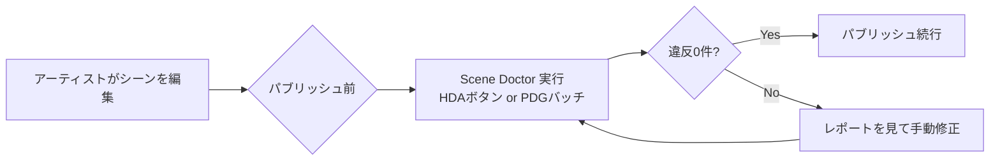
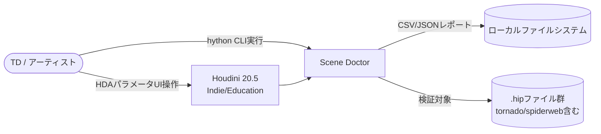
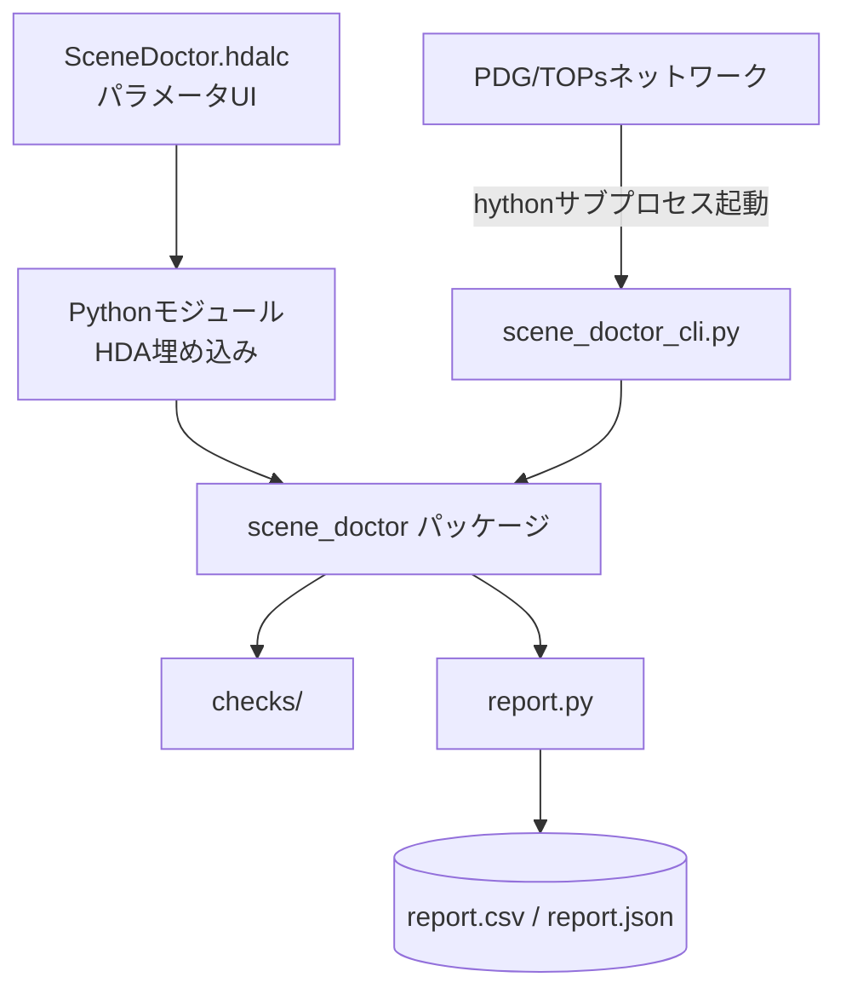
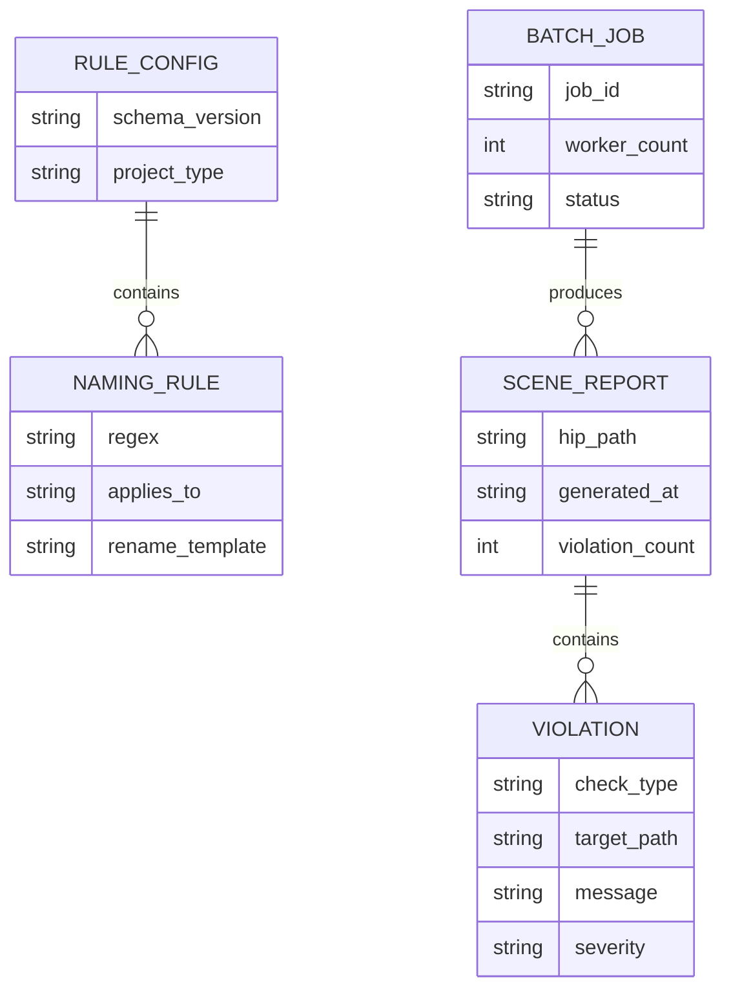
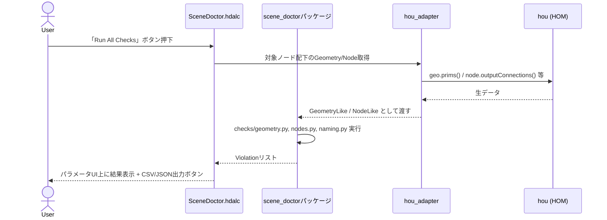
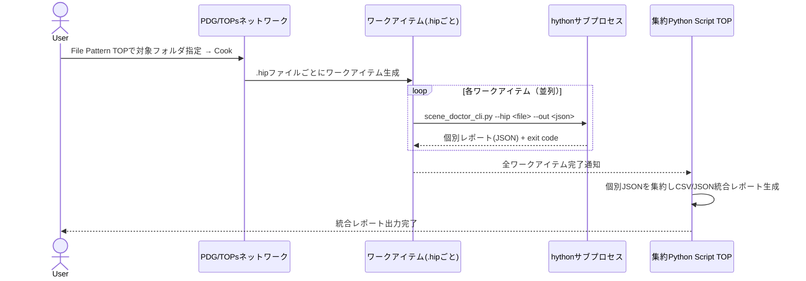

# 開発時要件定義: Houdini Scene Doctor

| 項目 | 値 |
|------|---|
| 版 | 0.1 |
| 作成日 | 2026-09-07 |
| 最終更新 | 2026-09-07 |
| ステータス | ドラフト |
| 著者 | 金子直樹 |
| 承認者 | 金子直樹（個人開発のためセルフ承認） |
| 関連 | [仕様書](./仕様書.md) ／ 姉妹プロジェクト [PipeInit 要件定義書 v2](../../../dev/pipeinit/docs/要件定義書_v2.md) |
| プロジェクトタイプ | MVP / 個人開発ポートフォリオ |

> **本書の位置づけ**: 転職活動用に作成する3本のポートフォリオのうち2本目。1本目「PipeInit」で受けたフィードバック（「v1は情報が少なすぎる、隙のない網羅的な文書にすべき」）を踏まえ、**最初からv2相当の深さ**（FRのコード相当の詳細記述・テストケース20件超・脅威モデル・面接想定問答5問）で作成している。

---

## 1. 文書管理・メタ情報

### 1.1 改訂履歴

| 版 | 日付 | 変更概要 | 承認者 |
|---|---|---|---|
| 0.1 | 2026-09-07 | 初版作成（v2相当の深さで一括作成） | 金子直樹 |

### 1.2 文書の位置づけ・想定読者

- **想定読者**: 自分自身（実装リファレンス）／ポートフォリオ審査者・面接官（設計思想の証明資料）。
- **参照頻度**: 実装期間中（2026-09-18〜10-08）は毎日参照する。特に§12（脅威モデル）・§13（テストケース）・§16.6（面接想定問答）は、面接でその場で深掘りされた際に開いて答えられる密度を意図している。

### 1.3 ステータスダッシュボード

| 項目 | 状態 |
|---|---|
| 要件定義 | ✅ On target |
| 仕様書 | ✅ On target（本書とペアで完成） |
| 実装 | 未着手（開始予定 2026-09-18） |
| リリース（GitHub公開） | 未着手（目標 2026-10-08） |

### 1.4 関連ドキュメント

- `docs/仕様書.md`（本書とペア、実装パラメータの正本）
- `docs/adr/`（ADR-0001〜0003、実装フェーズで追記）
- `.github/workflows/ci.yml`
- `~/3dcg-dev/houdini_dev/README.md`（hrpyc経由でHoudiniをVSCodeから操作する既存環境。本プロジェクトの実行基盤として一部流用）
- パイプライン転職ロードマップ（3プロジェクト共通の上位計画書。1本目=PipeInit、2本目=本プロジェクト、3本目=未定）

### 1.5 用語集・略語集

| 用語 | 説明 |
|---|---|
| SOP | Surface Operator。Houdiniのジオメトリ生成ノード群 |
| HOM | Houdini Object Model。Pythonから`hou`モジュール経由でHoudiniを操作するAPI体系 |
| HDA | Houdini Digital Asset。ノードネットワークを再利用可能な形でパッケージ化したもの（`.hda`/`.hdalc`） |
| PDG / TOPs | Procedural Dependency Graph / Task Operators。Houdini内でタスクの依存関係・並列実行を管理する仕組み |
| hython | Houdini同梱のPythonインタプリタ。`hou`モジュールを内蔵し、GUIなしでバッチ実行できる |
| 非多様体ジオメトリ（Non-manifold） | 1本のエッジを3枚以上の面が共有する等、実世界の面として矛盾した構造を持つポリゴンメッシュ |
| N-gon | 5角形以上の多角形ポリゴン。サブディビジョンやシェーディングで破綻の原因になりやすい |
| ゼロ面積ポリゴン | 縮退（degenerate）した、実質的な面積を持たないポリゴン |
| ドライラン（Dry-run） | 実際の変更を行わず、結果のみを提示する実行モード |
| STRIDE | Spoofing/Tampering/Repudiation/Information Disclosure/DoS/Elevation of Privilege の脅威分類法 |
| bad_scene | 本プロジェクトにおいて、意図的に破損状態を含む検証用シーン（過去の習作 `tornado_00.hiplc` 等を再利用） |

### 1.6 参照標準・法令一覧

| 標準 | 版 | 適用範囲 | 適用理由 |
|---|---|---|---|
| ISO/IEC/IEEE 29148:2018 | - | 本要件定義書の章構成方針 | ドメイン知識スキル`requirements-pro`の準拠元 |
| ISO/IEC 25010 (JIS X 25010) | - | §6 非機能要件の品質特性分類（性能効率性・保守性・移植性） | ツール品質を業界標準の語彙で説明できるようにするため |
| OWASP Top 10:2021 | - | §12 セキュリティ（A03:インジェクション、A08:ソフトウェア/データ整合性の失敗のみ該当） | YAML安全読込・PDG実行コードの静的検証に直結 |
| SPDX 3.0.1 | - | §15 ライセンス表記（簡易） | OSS公開時のライセンス明示 |
| Conventional Commits 1.0.0 | - | §15 コミット規約 | `git-workflow.md`との整合 |

> <!-- 要レビュー --> PCI DSS / GDPR / NIST SP 800-63B-4 / WCAG 2.2は、決済・個人情報・Webの利用者向けGUIを一切持たないため対象外と判断する。この判断基準：「本ツールは認証・決済・個人データ・一般利用者向けUIを扱わない」。スコープ変更時（例: Webダッシュボード化）に再評価する運用とする。

### 1.7 トレーサビリティID体系

標準の `BR- / STK- / FR- / NFR- / SEC- / IF- / LEG- / TC-` を採用する（LEG・IFは本プロジェクトでは不使用）。`TC-`は§13.2で24件発番し、§13.4のマトリクスと完全に対応させる。

---

## 2. ビジネス要件

### 2.1 エレベーターピッチ

複数アーティストが触るHoudiniシーンは、非多様体ジオメトリ・ゼロ面積ポリゴン・未接続ノード・命名違反が静かに蓄積し、レンダー直前で発覚して手戻りを生む。Scene Doctorは、これをHDA/PDGバッチとして自動検出・レポート化するツールであり、「シーンの品質を見る目」をコード化する。

### 2.2 解くべき課題（定量化）

- VFX/ゲームFX制作現場では、破損ジオメトリや命名規則違反の発見がレンダー直前（QCフェーズ）にずれ込み、1件あたり数十分〜数時間の手戻りが発生する（一般的な現場感覚に基づく仮説。本ツールでは自分の過去シーンを使い、検出→修正のサイクルを実測して裏付ける）。
- 実測方法: `tornado_00.hiplc` / `spiderweb_v1.hip` / `spiderweb_v2.hip` を「意図的に壊れたテストシーン」として本ツールにかけ、検出できた具体的な欠陥数を面接時の説明材料とする（BR-005、KGI参照）。

### 2.3 ビジネスゴール（やること）と Non-Goals（やらないこと）

**やること（BR）**

| ID | 内容 |
|---|---|
| BR-001 | 非多様体・N-gon・ゼロ面積ポリゴンといったジオメトリ欠陥の自動検出により、レンダー直前の手戻りを減らせることを示す |
| BR-002 | 未接続ノード・命名規則違反の自動検出により、シーンの属人的な品質管理から脱却できることを示す |
| BR-003 | PDG（TOPs）による複数.hip一括バッチ処理で、単一シーンのチェックに留まらないスケーラビリティを示す |
| BR-004 | 検証ロジックをHDAとしてパッケージ化し、他プロジェクトへ再配布可能にすることで実務適用可能性を示す |
| BR-005 | 過去に自分が作った粗い習作シーン（tornado/spiderweb）を、自作ツールで検出・可視化し、技術的成長と実務直結のストーリーを両立させる（差別化ポイント） |

**Non-Goals（明確に対象外）**

1. レンダーファーム連携やレンダークラッシュログ解析など、レンダリング自体のエラー検出は対象外（ジオメトリ・ノード構造の静的検査に限定する）。
2. Houdini以外のDCC（Maya / Blender等）への対応は対象外。
3. 自動修正（オートフィックス）は対象外。v1のスコープはレポート出力とリネーム候補の**提示**に留め、実際の変更はユーザーの明示的な操作（HDAボタン押下 or `--apply`相当の確認フロー）を必須とする。
4. マルチユーザー同時実行・サーバー化・Web UI化は対象外（ローカルのHoudini環境で完結する個人開発ツール）。
5. 決済・認証・アカウント管理機能は存在しない。

### 2.4 KGI / KPI

```
KGI: 2026-11-01までにCGパイプラインエンジニアとして転職成功する
     （本プロジェクトはそのための3本のポートフォリオのうち2本目）

KPI（本プロジェクト固有）:
  - tornado_00.hiplc / spiderweb_v1.hip / spiderweb_v2.hip に対しScene Doctorを実行し、
    実際に検出した欠陥件数 ≥ 5件（非多様体・N-gon・ゼロ面積・未接続ノード・命名違反の合計）
  - 検出 → 手動修正 → 再検証で違反0件になることをBefore/Afterで実演できる
  - PDGバッチで3ファイル以上を並列処理し、1操作でCSV/JSONレポートを生成できる
  - pytestカバレッジ80%以上（hou依存を除くロジック部、CI上で計測）
  - HDAとして新規の別.hipファイルに導入し、追加コードなしで動作することを実演できる
```

### 2.5 ROI / 収益モデル

該当なし（収益を目的としない個人開発ポートフォリオ）。ROIは「転職成功による年収差分」という間接指標のみで捉え、本書では扱わない。

### 2.6 主要機能サマリ（トップ5）

1. ジオメトリ欠陥（非多様体・N-gon・ゼロ面積）の自動検出
2. 未接続・未使用ノードの検出とレポート出力
3. 命名規則違反ノードの検出とリネーム候補提示
4. PDGによる複数.hip並列バッチ処理とCSV/JSON出力
5. HDAとしての再配布可能なパッケージ化

### 2.7 システム化の範囲とOut of Scope

- **範囲内**: Houdini 20.5 Indie/Education上で完結する、ジオメトリ・ノード構造の静的検査とレポート出力。
- **Out of Scope**: §2.3のNon-Goals全項目。特に「自動修正」「他DCC対応」「Web化」は将来拡張の候補としてREADMEに明記するに留める。

### 2.8 前提条件・制約事項

| 区分 | 内容 |
|---|---|
| 技術 | Houdini 20.5 Indie/Education固定。バージョン差異による挙動変化は保証範囲外 |
| 予算 | 追加コストなし（既存のHoudiniライセンス・開発機材を流用） |
| 法令 | 該当なし（決済・個人情報を扱わないため） |
| 期間 | 2026-09-18〜2026-10-08の3週間。在職中の学習時間内で開発 |
| リソース | 開発者1名（金子直樹）。外注なし |
| **重要な制約** | `~/3dcg-dev/houdini_dev/houdini-mcp/` はgit remoteが`oculairmedia/houdini-mcp`という第三者OSSのクローンであり、本プロジェクトのオリジナル実装ではない。Scene Doctorの実装は完全に自作コードで行い、houdini-mcpには一切依存しない（利用・参考以上の形で扱わない）。この判断の理由は§16.6 Q4を参照 |

### 2.9 ステークホルダー定義

| ID | ステークホルダー | 役割・関心事 |
|---|---|---|
| STK-001 | 金子直樹（開発者兼利用者） | 実装・動作確認・面接での説明責任 |
| STK-002 | ポートフォリオ審査者・面接官 | 技術力・設計思想・実務適用可能性の評価 |
| STK-003 | （想定読者としての）スタジオのTD/パイプラインチーム | 本ツールが実際のスタジオ運用でどう使われうるかの評価軸として仮想的に設定 |

### 2.10 予算計画

追加費用なし。Houdini Indie/Educationライセンス・開発機材は既存資産を流用する。

### 2.11 体制

開発者1名がPM・設計・実装・テスト・ドキュメント作成のすべてを担う。外注領域なし。レビューアは自分自身（セルフレビュー）とし、`/code-review`（組込コマンド）で客観性を補う。

### 2.12 マスタースケジュール

| フェーズ | 期間 | 内容 |
|---|---|---|
| Week 1 | 2026-09-18〜09-24 | `checks/`（geometry / nodes / naming）とインターフェース層（DI）の実装、pytestでのモックテスト |
| Week 2 | 2026-09-25〜10-01 | HDA化、PDG（TOPs）バッチ処理、CSV/JSONレポート出力の実装 |
| Week 3 | 2026-10-02〜10-08 | tornado/spiderweb実データでの実演（Before/After）、README・ドキュメント整備、GitHub公開 |

---

## 3. 業務要件

### 3.1 As-Is業務フロー

複数アーティストが同一プロジェクトのHoudiniシーンを触る現場では、各自が目視・経験則でジオメトリやノードグラフの健全性を確認する。命名規則はREADMEやWiki等の紙上ルールに依存し、実施の担保がない。破損は多くの場合、レンダーやシミュレーションの実行時エラーとして初めて顕在化する。

### 3.2 To-Be業務フロー

ショット/アセットの公開（パブリッシュ）前、あるいはCI相当のタイミングでScene Doctorを実行し、欠陥・違反を自動レポート化する。アーティストはレポートを見て該当ノードへジャンプし、手動で修正する（自動修正は非対応、§2.3）。



### 3.3 業務ルール・制約・例外パターン

- 検証はシーンの**読み取り専用**操作として行い、Scene Doctor自身がシーンを書き換えることはない（リネームは提示のみ、実行はユーザー操作）。
- 検証対象外にしたいノード（意図的な未接続の作業用ノード等）は、命名規則やコメントタグ（例: `WIP_`プレフィックス）で除外できるようにする（仕様書§7で詳細化）。

### 3.4 ペルソナ

```
名前: 田中サトシ（仮）
役職: 中規模VFXスタジオのジュニアTD（2年目）
ITリテラシー: Houdiniは日常的に使うが、Pythonでのツール開発は独学レベル
利用デバイス: スタジオ支給のWindows/Linuxワークステーション
利用コンテキスト: 複数アーティストが触った後のシーンを、パブリッシュ前にチェックする係を任されている
ジョブ（JTBD）: 「レンダー直前ではなく、パブリッシュ前の数分で壊れたシーンを見つけたい」
ペイン: 目視チェックに時間がかかり、見落としがそのままレンダー事故につながる
ゲイン: 自動レポートで確認時間を数分に短縮し、見落としをゼロに近づける
```

### 3.5 カスタマージャーニーマップ

| ステージ | 内容 |
|---|---|
| 認知 | HDAとしてスタジオの共有ライブラリに追加されているのを見つける |
| 導入 | パラメータUIから対象シーン/フォルダを指定し実行 |
| 定常利用 | パブリッシュ前チェックの定型作業として毎回実行 |
| 拡張利用 | PDGバッチで複数ショットをまとめて夜間チェック |

### 3.6 オンボーディング要件

HDAのパラメータUIに「Run All Checks」ボタン1つを用意し、初回利用時に迷わないようにする（詳細は仕様書§6）。

### 3.7 業務トランザクション一覧

| トランザクション | 内容 |
|---|---|
| 単一シーンチェック | HDAボタン押下で現在開いているシーン（またはノード配下）を検証 |
| バッチチェック | PDGで指定フォルダ配下の複数.hipファイルを並列検証 |
| リネーム適用 | 命名違反ノードに対し、提示された候補で実際にリネームする（明示操作） |

### 3.8 業務頻度・繁閑差

個人開発ポートフォリオのため実運用頻度は想定しないが、設計上は「ショット公開のたびに実行される」高頻度・低負荷（1シーンあたり数秒〜十数秒）の利用を想定する。

---

## 4. システム要件・アーキテクチャ

### 4.1 動作環境

| 項目 | 内容 |
|---|---|
| Houdini | 20.5 Indie / Education 固定（`~/3dcg-dev/houdini_dev`の既存環境を実行基盤として流用） |
| Python | Houdini同梱のhython（Python 3.11系、Houdini 20.5のビルドに準拠） |
| OS | macOS（開発機）。Windows/Linuxでの動作は`pathlib`ベースの実装により理論上可能だが検証範囲外とする |
| 実行方式 | (a) Houdini GUI上でHDAのパラメータUIから実行、(b) `hython scene_doctor_cli.py`によるバッチ/CI相当の実行 |

### 4.2 アーキテクチャ方式

**Ports & Adapters（Hexagonal Architecture）** を採用する。理由: `hou`モジュールはHoudiniプロセス内でしか利用できず、素のpytestでは直接テストできない。検証ロジック（`checks/`）を`hou`から完全に分離し、薄いアダプタ層（`adapters/hou_adapter.py`）だけが`hou`に依存する構成にすることで、FR-006（依存性逆転・モック可能化）を実現する（詳細はADR-0001）。

```mermaid
flowchart TB
  subgraph Houdiniプロセス内のみ
    HOU[hou モジュール]
    ADAPTER[adapters/hou_adapter.py\nHouGeometryAdapter / HouNodeAdapter]
  end
  subgraph 純粋Python（hou非依存・pytest対象）
    IFACE[interfaces.py\nGeometryLike / NodeLike Protocol]
    CHECKS[checks/\ngeometry.py / nodes.py / naming.py]
    REPORT[report.py\nCSV/JSON出力]
  end
  HOU --> ADAPTER
  ADAPTER -->|Protocolを満たすオブジェクトとして渡す| CHECKS
  IFACE -.型定義のみ.-> CHECKS
  CHECKS --> REPORT
```

### 4.3 C4 Model

**Context図**



**Container図**



### 4.4 技術スタック確定表

| カテゴリ | 採用 | バージョン | 選定理由 | 代替案 | 却下理由 |
|---|---|---|---|---|---|
| DCC | Houdini | 20.5 Indie/Education | 既存資産（習作シーン・hrpyc環境）を流用でき、PDGが標準搭載 | Houdini FX | ライセンス費用が個人開発に見合わない |
| 言語 | Python (HOM) | hython同梱の3.11系 | Houdini標準のスクリプティング言語、既存hrpyc資産と親和性 | VEX単独 | ノード操作・ファイルI/Oを伴う検証ロジックには不向き |
| 計算記述 | VEX | Houdini同梱 | ジオメトリ属性の高速計算が必要な箇所（面積計算の一部検証等）で補助的に使用 | Python内で全計算 | 大規模ポリゴンでの速度が課題になり得るため選択肢として保持 |
| バッチ | PDG (TOPs) | Houdini 20.5同梱 | Houdini標準の依存関係管理・並列実行基盤。ワークアイテムの成否管理・再実行キャッシュを持つ | シェルスクリプト + GNU parallel | 依存関係・リトライ・Houdiniパイプラインへの組み込みやすさで劣る（§16.6 Q2で詳述） |
| テスト | pytest | 8.x系 | Houdiniライセンスなしでも`hou`をモックしてCI実行可能 | unittest | pytestの方がfixture/parametrizeの表現力が高い |
| 設定 | YAML | PyYAML | 命名規則をスタジオごとに切り替え可能にする（PipeInitと同じ設計判断を踏襲） | JSON | コメント記述ができずルールファイルとしての可読性で劣る |

### 4.5 環境構成

環境は`local`のみ（Houdini GUI環境 + hythonバッチ環境の2実行経路）。CI（GitHub Actions）はHoudiniライセンスを持たないため、`checks/`の純粋Python部分のみをpytestで実行し、HDA・PDG部分の動作確認は手動E2Eに委ねる（§13.1）。

### 4.6 12-Factor準拠チェック（簡易）

Webサービスではないため大半の因子は直接適用されないが、精神は踏襲する。

| 因子 | 適用状況 |
|---|---|
| 設定 | 命名規則等はYAMLファイル（環境変数ではなく設定ファイルとして分離）で外部化 |
| 依存関係の明示 | `pyproject.toml`で依存を明示（§14.4） |
| ログ | 標準出力へのログ出力とし、ファイル保存はレポート出力機能に限定 |
| 並行性 | PDGのワークアイテム並列度で表現（プロセスモデルの類推） |
| （その他多くの因子） | Webサービス特有の因子（バックエンドサービス・ポートバインディング等）は非該当 |

### 4.7 データモデル



### 4.8 データボリューム見積

| シナリオ | ポリゴン数 | ノード数 | 想定実行時間（NFR-001目標） |
|---|---|---|---|
| 小規模（習作シーン相当、tornado/spiderweb） | 〜1万 | 〜100 | 2秒以内 |
| 中規模（一般的なショットシーン想定） | 〜10万 | 〜500 | 10秒以内 |
| 大規模（プロダクションアセット想定） | 〜100万 | 〜2,000 | 未保証（本プロジェクトのスコープ外、§16.6 Q2で設計判断を説明） |

### 4.9 シーケンス図

**単一シーンの対話的チェック（HDA）**



**PDGバッチチェック**



### 4.10 ADR運用方針

`docs/adr/NNNN-decision-title.md` にMichael Nygard形式で記録する。

| ADR | タイトル | ステータス |
|---|---|---|
| ADR-0001 | Ports & Adapters採用によるhouからの検証ロジック分離 | Accepted（本文は仕様書§14.2） |
| ADR-0002 | バッチ処理にシェル並列ではなくPDG（TOPs）を採用 | Accepted（本文は仕様書§14.3） |
| ADR-0003 | 自動修正ではなくレポート＋提示に留める設計 | Accepted（本文は仕様書§14.4） |

### 4.11 クラウドポータビリティ

該当なし（Houdiniライセンスに紐づくローカル実行ツールであり、クラウド展開を想定しない）。

---

## 5. 機能要件

### 5.1 機能一覧

| ID | 機能 | 優先度 |
|---|---|---|
| FR-001 | 非多様体ジオメトリ・N-gon・ゼロ面積ポリゴンの検出 | Must |
| FR-002 | 未使用／未接続ノードの検出とレポート出力 | Must |
| FR-003 | 命名規則違反ノードのハイライトとリネーム候補提示 | Must |
| FR-004 | PDG（TOPs）による複数.hip並列バッチ処理とCSV/JSON出力 | Must |
| FR-005 | HDAとしてのパッケージ化・再配布可能化 | Must |
| FR-006 | 検証ロジックのhouからの分離（依存性逆転・pytestモック可能化） | Must |

### 5.2〜5.3 アカウント・権限機能／権限マトリクス

該当なし（単一ユーザー・ローカル実行のツールであり、アカウント・権限の概念を持たない）。

### 5.4 機能詳細

```markdown
### FR-001 非多様体ジオメトリ・N-gon・ゼロ面積ポリゴンの検出

- **優先度**: Must
- **関連BR**: BR-001, BR-005
- **Description**: 指定SOPノードの出力ジオメトリに対し、(a) 非多様体エッジ、(b) 指定閾値を超える多角形（N-gon）、(c) 面積が閾値未満の縮退ポリゴン、を検出する
- **Inputs**:
  | パラメータ | 型 | 必須 | 既定値 | バリデーション |
  |---|---|---|---|---|
  | target_node | node path | ◯ | - | SOPノードでなければE003 |
  | ngon_threshold | int | - | 5（5角形以上をN-gon扱い） | 3未満はE002 |
  | zero_area_epsilon | float | - | 1e-6 | 0以下はE002 |
- **Processing**:
  1. `adapters/hou_adapter.py`が`target_node`の出力ジオメトリを`GeometryLike`アダプタでラップする
  2. `checks/geometry.py::check_nonmanifold()` が全プリミティブの頂点ペアからエッジ→隣接面数のハッシュマップを構築し、隣接面数が2以外のエッジを非多様体として記録する（O(E)で判定、§8実装詳細は仕様書側）
  3. `check_ngons()` が各プリミティブの頂点数を`ngon_threshold`と比較する
  4. `check_zero_area()` が各プリミティブの面積を`zero_area_epsilon`と比較する
  5. 検出結果を`Violation`データクラスのリストとして返す
- **Outputs**:
  - 成功時: 違反0件なら「No geometry violations found.」、N件ならリスト（プリミティブ番号・違反種別・詳細）
  - 失敗時: エラーコード（E001〜E005）
- **UseCase**: パブリッシュ前のジオメトリ健全性チェック
- **受入条件（AC）**:
  1. 全プリミティブがmanifoldなジオメトリでは非多様体検出0件
  2. `ngon_threshold=5`（既定）で四角形までは検出せず、五角形以上のみ検出する
  3. `ngon_threshold=3`に変更すると四角形も検出対象になる（閾値が可変であることの確認）
  4. 面積が`zero_area_epsilon`未満のポリゴンのみを検出し、境界値付近（僅かに閾値を上回る）は誤検出しない
  5. 空のジオメトリ（0プリミティブ）に対してもエラーにならず「0件」で正常終了する
  6. `target_node`がSOPノードでない場合はE003で早期終了する
  7. 10万ポリゴン規模のジオメトリでもNFR-001（10秒以内）を満たす

### FR-002 未使用／未接続ノードの検出とレポート出力

- **優先度**: Must
- **関連BR**: BR-002
- **Description**: 指定ネットワーク配下のノードグラフを走査し、(a) 出力接続を持たず末端（Display/Renderフラグ等が立っていない）でもない「浮いた」ノード、(b) バイパス済みで実質未使用のノード、を検出する
- **Inputs**:
  | パラメータ | 型 | 必須 | 既定値 |
  |---|---|---|---|
  | target_network | node path | ◯ | - |
  | recurse_into_subnets | bool | - | true |
- **Processing**:
  1. `NodeLike`アダプタで`target_network`配下の全ノードを取得する
  2. 各ノードについて`outputConnections()`・`isDisplayFlagSet()`・`isRenderFlagSet()`・`isBypassed()`を確認する
  3. 出力接続0かつDisplay/Renderフラグいずれも立っていないノードを「未接続」として記録する
  4. `isBypassed()`が真のノードを「未使用（バイパス）」として別カテゴリで記録する
  5. `recurse_into_subnets`が真の場合、Subnetworkノードの内部も再帰的に走査する
- **Outputs**: 未接続ノード一覧・未使用（バイパス）ノード一覧（ノードパス・種別）
- **UseCase**: ノードグラフの整理・レビュー
- **受入条件（AC）**:
  1. 出力接続0だがDisplay/Renderフラグが立つ末端ノード（正常なleaf）は誤検出しない
  2. バイパス済みノードは「未接続」ではなく「未使用（バイパス）」として区別して報告する
  3. Subnetwork内部のノードも既定で再帰的に走査対象になる
  4. `recurse_into_subnets=false`の場合、Subnetwork内部は走査しない

### FR-003 命名規則違反ノードのハイライトとリネーム候補提示

- **優先度**: Must
- **関連BR**: BR-002
- **Description**: YAML定義された命名規則（正規表現）に違反するノードを検出し、ネットワークエディタ上でハイライトし、規則に沿ったリネーム候補を提示する
- **Inputs**:
  | パラメータ | 型 | 必須 | 既定値 |
  |---|---|---|---|
  | naming_rules_path | path | - | `rules/default.yaml` |
  | target_network | node path | ◯ | - |
- **Processing**:
  1. `naming_rules_path`を`yaml.safe_load`で読込（SEC-001）
  2. 各ノードについて、ノードタイプに対応する`applies_to`ルールとのみ照合する
  3. いずれのパターンにも一致しないノードを違反として記録する
  4. 違反ノードには`rename_template`から命名候補を生成する（例: `{type}_{seq:03d}`）
  5. 候補が既存ノード名と衝突する場合、連番サフィックスを付与して再生成する
  6. HDA実行時のみ、違反ノードに対し`hou.Node.setColor()`で警告色を設定する（読み取り専用チェックには影響しない副作用として明示）
- **Outputs**: 違反ノード一覧（現在名・違反理由・リネーム候補）
- **UseCase**: 命名規則の定常的な遵守確認
- **受入条件（AC）**:
  1. 規則を満たすノード名は違反として検出しない
  2. 違反ノードごとに一意なリネーム候補が生成される（衝突時は連番で回避）
  3. リネームは提示のみで、ユーザーが明示的に適用操作をしない限りノード名は変更されない（Non-Goals §2.3と整合）
  4. ハイライト（色設定）はHDA実行時のみの副作用であり、`checks/naming.py`単体のpytestではノードの色を変更しない（純粋関数として検証可能）

### FR-004 PDG（TOPs）による複数.hip並列バッチ処理とCSV/JSON出力

- **優先度**: Must
- **関連BR**: BR-003
- **Description**: 指定フォルダ配下の複数`.hip`ファイルをPDGのワークアイテムとして展開し、各ファイルに対しFR-001〜003相当のチェックを並列実行、結果をCSV/JSONに集約する
- **Inputs**:
  | パラメータ | 型 | 必須 | 既定値 |
  |---|---|---|---|
  | target_dir | path | ◯ | - |
  | worker_count | int | - | CPU論理コア数 |
  | output_format | choice(csv/json/both) | - | both |
- **Processing**:
  1. File Pattern TOPが`target_dir`配下の`*.hip` / `*.hiplc`を列挙しワークアイテム化する
  2. 各ワークアイテムに対しPython Script TOPが`hython scene_doctor_cli.py --hip <file> --out <tmp_json>`をサブプロセス起動する（プロセス分離、SEC-004）
  3. 1ファイルの処理が失敗（異常終了）しても、PDGのワークアイテム管理により他のワークアイテムは継続する
  4. 全ワークアイテム完了後、集約Python Script TOPが個別JSONを読み込み、CSV/JSON統合レポートを生成する
  5. 同一`target_dir`への再実行は、既存レポートを冪等的に上書きする
- **Outputs**: `report.csv` / `report.json`（集約レポート）+ 個別ファイルごとの中間JSON
- **UseCase**: 夜間バッチや複数ショットの一括QC
- **受入条件（AC）**:
  1. 3ファイル以上を指定した場合、個別レポート3件+集約レポート1件が生成される
  2. 1ファイルの処理中に例外が発生しても、他のワークアイテムの処理結果は失われない
  3. 同一バッチを2回実行しても、集約レポートの内容は同一（決定的）である
  4. `worker_count`を明示指定した場合、PDGスケジューラの並列度に反映される
  5. CSV出力のカラム構成はJSON出力の内容と1対1で対応する

### FR-005 HDAとしてのパッケージ化・再配布可能化

- **優先度**: Must
- **関連BR**: BR-004
- **Description**: FR-001〜004の機能を`SceneDoctor.hdalc`としてパッケージ化し、他の`.hip`プロジェクトへコピーするだけで導入できるようにする
- **Processing**:
  1. HDAのPythonモジュール内に`scene_doctor`パッケージを埋め込み、外部pip依存を最小化する（PyYAMLのみ外部依存として明記）
  2. パラメータUI（仕様書§6で詳細化）から対象ノード・実行ボタン・結果表示・エクスポートボタンを提供する
- **受入条件（AC）**:
  1. クリーンな新規`.hip`ファイルにHDAをインストールし、追加のパッケージインストール作業なしで実行できる（PyYAMLはHoudini同梱のPython環境に含まれることを前提とし、含まれない場合はHDAの説明にインストール手順を明記する）
  2. HDAのバージョン番号がノードタイプ定義に含まれ、`hou.HDADefinition.version()`で確認できる

### FR-006 検証ロジックのhouからの分離（依存性逆転・pytestモック可能化）

- **優先度**: Must
- **関連BR**: BR-004
- **Description**: `checks/`配下のモジュールが`hou`を一切importしない設計とし、Houdiniライセンスなしのローカル/CI環境でpytestを完結させる
- **Processing**:
  1. `interfaces.py`に`GeometryLike` / `NodeLike`（`typing.Protocol`）を定義する
  2. `adapters/hou_adapter.py`が実際の`hou.Geometry` / `hou.Node`をラップし、Protocolを満たすアダプタを提供する（Houdiniプロセス内でのみimportされる）
  3. `tests/fakes.py`に、同じProtocolを満たす純粋Pythonのフェイクオブジェクトを用意する
  4. `checks/`のテストは全て`tests/fakes.py`のフェイクを注入して実行する
- **受入条件（AC）**:
  1. `checks/geometry.py` / `checks/nodes.py` / `checks/naming.py`のいずれも`import hou`を含まないことを静的チェック（grep/flake8カスタムルール）で保証する
  2. 全checksのpytestがHoudini/houを一切importせずに完結する（`pip install pytest pyyaml`のみでCI実行可能）
  3. `adapters/hou_adapter.py`のみがHoudini環境依存であり、この部分は手動E2E（§13.1）で確認する

### 5.5 業務ロジック・計算式

仕様書§8（business-logic）を正本とする（非多様体判定・面積計算・リネーム候補生成のアルゴリズムはコードレベルの詳細を要するため仕様書側に集約する）。

### 5.6〜5.11

該当なし。検索機能・ファイルアップロード/ダウンロード・通知・帳票出力・問い合わせ機能・管理画面は、単一ユーザーのローカル実行CLI/HDAという性質上、実体が生まれない。

### 5.12 エラー・例外処理方針

| エラーコード | 意味 |
|---|---|
| E001 | 対象`.hip`ファイルが存在しない、またはHoudiniで開けない |
| E002 | 不正なパラメータ値（閾値が範囲外等） |
| E003 | 指定ノードが期待する種別（SOP/ネットワーク等）でない |
| E004 | 命名規則YAMLの構文エラー・必須キー欠落 |
| E005 | 出力先ディレクトリへの書き込み権限がない |

すべてのエラーはユーザー向けメッセージ（何が起きたか・どう直すか）と、`--verbose`相当のフラグ時のみ表示する開発者向けスタックトレースを分離する。

---

## 6. 非機能要件（IPA + ISO 25010）

> IPA非機能要求グレード選定: **グレード1（基本）**。個人向け無料ツールであり、決済・医療・金融のような社会的影響度の高い用途を想定しないため。

### 6.1 性能要件

```
NFR-001 単一シーンチェック性能
- 対象: ポリゴン数10万・ノード数500規模のシーン
- 目標: 全チェック（FR-001〜003）の実行が10秒以内

NFR-002 バッチ処理のスケーラビリティ
- 対象: 10ファイルのPDGバッチ処理
- 目標: 4ワーカー並列実行時、逐次実行（1ワーカー）に対し合計処理時間を50%以上短縮
```

### 6.2 リソース使用（保守運用性の一部として明記）

```
NFR-003 メモリ使用量
- hythonサブプロセス1つあたりのメモリ使用量が2GBを超えないことを目安とする
- 測定方法: `psutil`等でサブプロセスのRSSを計測し、tests/benchmark.pyの実行時にログ出力する（自動アサートはせず、手動確認に留める＝スコープクリープ防止）
```

### 6.3 保守運用性

```
NFR-004 テスト容易性
- checks/配下のロジックはhou非依存であり、Houdiniライセンスがない環境（GitHub Actions等）でも
  pytestが完結すること（FR-006のAC-2と同一基準）
```

### 6.4 移植性

```
NFR-005 再配布可能性
- HDAファイル（.hdalc）1つをコピーするだけで、別の.hipプロジェクトに導入できること（FR-005参照）
```

### 6.5〜6.8 可用性・ユーザビリティ・エコロジー・信頼性・互換性

いずれも個人向けローカルツールの性質上、SLA・多言語対応・CO2排出計測等の重点度は低いと判断し、最小限の記述に留める（重点度マトリクスでMVP/PoCは★☆☆と整理）。互換性についてのみ以下を明記する。

```
NFR-006 バージョン互換性
- Houdini 20.5系のみサポート対象とする。20.0以前・21.0以降での動作は未検証・未保証と明記する
```

### 6.9 性能要件の測定方法

NFR-001/002は自己申告の目標値ではなく、以下の方法で実測・検証する。

```
測定スクリプト: tests/benchmark.py（hython経由で実行、pytestとは別立て）
測定条件: sample_scenes/配下に生成した中規模フィクスチャシーン（10万ポリゴン・500ノード相当）
CI組み込み: 手動実行のみ（Houdiniライセンスが必要なためCI環境では自動化しない。これはスコープクリープを防ぐ意図的な判断）
合格基準: NFR-001（10秒以内）を3回中2回以上満たす
```

---

## 7. デザイン・UI/UX要件

本ツールはGUIアプリケーションではなく、HoudiniのHDAパラメータUIとCLIのみで構成される。したがってWeb/モバイル向けのデザインシステム・WCAG・i18n等は該当しない（重点度マトリクスでMVPは★☆☆と整理）。HDAパラメータUIの具体的なレイアウト・項目定義は、screen-specの読み替えとして仕様書§6「HDAパラメータインターフェース仕様」に記載する。

---

## 8〜11. マーケティング／課金・決済／API・外部連携／バッチ・非同期処理

該当なし。CG制作パイプライン向けのローカル実行ツールであり、マーケティング・決済・外部API連携の実体が生まれない。バッチ処理（PDG）はFR-004として§5・仕様書§10（async-and-batch）で扱うため、本章では重複記載しない。

---

## 12. セキュリティ要件

### 12.1 実装要件

| SEC-ID | 内容 |
|---|---|
| SEC-001 | 命名規則YAMLの読込は`yaml.safe_load`のみを使用し、任意コード実行を防止する |
| SEC-002 | PDGのPython Script TOPで実行するコードはリポジトリ内の固定スクリプト（`scene_doctor_cli.py`）のみとし、動的な文字列を`exec`/`eval`しない |
| SEC-003 | Scene Doctor自身はシーンファイルを書き換えない（読み取り専用）。リネーム等の変更はユーザーの明示操作を必須とする |
| SEC-004 | PDGバッチ処理は各`.hip`ファイルの処理をサブプロセス（hython）として分離し、1ファイルの異常終了が他のワークアイテムに影響しないようにする |
| SEC-005 | 依存ライブラリ（PyYAML等、pytest実行専用のPython環境）の脆弱性をCI上で`pip-audit`によりチェックする |

### 12.2 信頼境界の考え方（Houdiniのコード実行機能について）

> Houdiniの`.hip`ファイルはPythonノード・式（Expression）・シェルフツール等を内包でき、**Houdiniがファイルを開いた時点で任意のPythonコードが実行されうる**（これはHoudini自体が本来的に持つ特性であり、Scene Doctorが新たに生み出すリスクではない）。この前提のもと、Scene Doctorの脅威モデルは以下のように信頼境界を引く。

- **信頼境界の内側**: 自分自身が作成した`.hip`ファイル（`tornado_00.hiplc`・`spiderweb_v1/v2.hip`等）、および将来的にスタジオ内で共有される前提の`.hip`ファイル。これらは「出所が既知の入力」として扱う。
- **信頼境界の外側**: 出所不明の`.hip`ファイル。Scene Doctorはこれを検証対象として受け取ることを想定するが、Houdini自体がファイルを開いた時点でコード実行のリスクがあるため、**「出所不明の`.hip`は開かない」という運用ルール**をREADMEに明記する。Scene Doctorはこのリスクを増減させない（`hou.hipFile.load()`を呼ぶだけであり、Houdini本体の責務を代替・拡張しない）ことを明示する。
- Scene Doctor自身のコード（`checks/` `report.py` `scene_doctor_cli.py`）は、`exec`・`eval`・`yaml.load`（safe_loadでない版）を一切使用しない（SEC-001, SEC-002）。

### 12.3 脅威モデル（STRIDE簡易版）

| 脅威分類 | シナリオ | 対策 |
|---|---|---|
| Tampering（改ざん） | 命名規則YAMLに`!!python/object`タグ等を仕込み、任意コード実行を狙う | SEC-001（`yaml.safe_load`必須化） |
| Tampering（改ざん） | 悪意ある`.hip`ファイルにPythonノード/Expressionが仕込まれ、Houdiniが開いた時点でコード実行される | §12.2の信頼境界の考え方に基づき運用ルールで対応（Scene Doctor自体では防止不可能な領域と明示） |
| Repudiation（否認） | 該当なし（単一ユーザー・ローカル実行のため、操作主体の否認は問題にならない） | - |
| Information Disclosure | レポート（CSV/JSON）に絶対パスが含まれ、第三者と共有した際に環境情報が漏れる | レポート出力時に`target_dir`基準の相対パスへ変換するオプションを提供する（仕様書§5で詳細化） |
| Denial of Service | 巨大な命名規則（ネストした量指定子を含む正規表現）によるReDoS、または極端に大きいシーンでの処理時間爆発 | 命名規則YAMLはスタジオ管理者（＝自分自身）が作成する信頼済み入力と想定するが、ReDoSを起こしやすいパターンについてREADMEのDesign Decisionsで注意喚起する |
| Elevation of Privilege | 該当なし（OS権限の昇格を伴う操作を行わない） | - |

### 12.4 想定攻撃者・信頼境界（まとめ）

本ツールは「命名規則YAMLはスタジオ管理者（自分自身）が作成する信頼済み入力」「検証対象の`.hip`ファイルは既知の出所を持つ」という前提に立つ。外部ネットワークからの入力は存在しないため、脅威モデルの主眼は「設定ミス・誤操作からの保護」（SEC-003の読み取り専用原則）と「Houdini自体が持つコード実行機能についての正しい理解を利用者に促すこと」（§12.2）に置いている。

---

## 13. テスト・品質保証要件

### 13.1 テスト戦略

```
Unit（checks/の各判定ロジック、hou非依存・フェイク注入）: 65%
統合テスト（scene_doctor_cli.pyのCLI層、フェイク経由）      : 20%
手動E2E（実Houdini環境でのHDA動作・PDGバッチ動作確認）      : 15%
```

### 13.2 テストケース一覧（TC-ID、24件）

| TC-ID | 対象FR | 内容 | 期待結果 |
|---|---|---|---|
| TC-001 | FR-001 | 全プリミティブがmanifoldなフェイクジオメトリを検証 | 非多様体検出0件 |
| TC-002 | FR-001 | 3枚以上の面が1辺を共有するフェイクジオメトリを検証 | 該当エッジが非多様体として検出される |
| TC-003 | FR-001 | 五角形プリミティブを含むジオメトリ（既定閾値5） | N-gonとして検出される |
| TC-004 | FR-001 | 四角形のみのジオメトリ（既定閾値5） | N-gonとして検出されない |
| TC-005 | FR-001 | `ngon_threshold=3`に変更 | 四角形もN-gonとして検出される |
| TC-006 | FR-001 | 面積が`zero_area_epsilon`未満の縮退ポリゴンを含む | ゼロ面積ポリゴンとして検出される |
| TC-007 | FR-001 | 面積が閾値をわずかに上回るポリゴン | 誤検出されない |
| TC-008 | FR-001 | 空のジオメトリ（0プリミティブ） | エラーにならず「0件」で正常終了 |
| TC-009 | FR-001 | SOPでないノードを`target_node`に指定 | E003 |
| TC-010 | FR-002 | 出力接続0だがDisplayフラグが立つ末端ノード | 未接続として誤検出されない |
| TC-011 | FR-002 | 出力接続0かつDisplay/Renderフラグなしの中間ノード | 未接続として検出される |
| TC-012 | FR-002 | バイパス済みノード | 「未使用（バイパス）」として区別して検出される |
| TC-013 | FR-002 | Subnetwork内部にも未接続ノードがある場合（既定設定） | 再帰的に検出される |
| TC-014 | FR-002 | `recurse_into_subnets=false` | Subnetwork内部は走査されない |
| TC-015 | FR-003 | 命名規則を満たすノード名 | 違反として検出されない |
| TC-016 | FR-003 | 命名規則に違反するノード名 | 違反として検出され、リネーム候補が生成される |
| TC-017 | FR-003 | リネーム候補が既存ノード名と衝突するケース | 連番サフィックス付きの候補が生成される |
| TC-018 | FR-004 | 3つの.hipファイルをPDGバッチ処理 | 個別レポート3件＋集約レポート1件が生成される |
| TC-019 | FR-004 | バッチ中の1ファイルが異常終了する状況を模擬 | 他のワークアイテムの処理結果は失われない |
| TC-020 | FR-004 | 同一バッチを2回実行 | 集約レポートの内容が決定的に一致する |
| TC-021 | FR-006 | `checks/`配下の全モジュールに対する静的チェック | `import hou`を含まないことが確認できる |
| TC-022 | SEC-001 | 命名規則YAMLの読込コードをレビュー | `yaml.safe_load`が使われていることを確認 |
| TC-023 | 実データ回帰 | `tornado_00.hiplc`に対し全チェックを実行（手動E2E） | 既知の欠陥（非多様体等）を検出できることを確認し、検出件数を記録する |
| TC-024 | 実データ回帰 | `spiderweb_v1.hip`と`spiderweb_v2.hip`を比較検証（手動E2E） | v1とv2の違反件数の差分をレポートできることを確認する |

### 13.3 受入・検収基準（Definition of Done）

- [ ] §5の全FR（Must優先度）に対応するテストが存在する
- [ ] TC-001〜022が全てpytestとして実装され、CI上でgreen（TC-023, 024は手動E2Eのためこの限りでない）
- [ ] pytestカバレッジ80%以上（`checks/` `report.py`等のhou非依存部分）
- [ ] `tornado_00.hiplc` / `spiderweb_v1.hip` / `spiderweb_v2.hip`に対する実行結果（Before）と、手動修正後の再検証結果（After）がREADMEにスクリーンショット/GIF付きで記録されている
- [ ] PDGバッチによる3ファイル以上の並列処理が実際のHoudini環境で確認済み

### 13.4 トレーサビリティマトリクス

| BR-ID | STK-ID | FR-ID | NFR/SEC-ID | TC-ID |
|---|---|---|---|---|
| BR-001 | STK-001 | FR-001 | NFR-001 | TC-001〜009 |
| BR-002 | STK-001 | FR-002 | - | TC-010〜014 |
| BR-002 | STK-001 | FR-003 | SEC-001 | TC-015〜017, TC-022 |
| BR-003 | STK-003 | FR-004 | NFR-002, SEC-004 | TC-018〜020 |
| BR-004 | STK-002 | FR-005, FR-006 | NFR-004, NFR-005 | TC-021 |
| BR-005 | STK-002 | FR-001〜004 | - | TC-023, TC-024 |

### 13.5 CI/CD品質ゲート

lint（flake8）→ format確認（black --check）→ import順序（isort --check）→ mypy → pytest（カバレッジ計測、hou非依存部分のみ）→ pip-audit の順でGitHub Actions上で実行し、いずれか失敗でマージ不可とする（仕様書§11で完全なYAML定義）。

---

## 14. インフラ・DevOps・SRE要件

該当なし（個人開発・ローカル実行ツールのため、クラウドインフラ・SRE運用体制を持たない）。CI/CDのみ§13.5・仕様書§11で扱う。

---

## 15. 開発プロセス・規約

- **Git戦略**: GitHub Flow（`main`保護、機能ブランチ`feat/*` `fix/*`）
- **コミット規約**: Conventional Commits 1.0.0
- **コーディング規約**: black / flake8 / isort / mypy strict、Googleスタイルdocstring
- **ライセンス**: MIT（OSS公開時）
- **ドキュメント運用**: README（Design Decisions節を含む）/ CHANGELOG / `docs/adr/`（MADR/Nygard形式）

---

## 16. リリース・移行計画

### 16.1 マスタースケジュール

§2.12参照。

### 16.2 開発フェーズ判定基準

```
Week1完了条件: checks/の全ロジックがpytestでgreen、カバレッジ80%以上（hou非依存部分）
Week2完了条件: HDAが新規.hipで動作、PDGバッチが3ファイル以上で成功
Week3完了条件（GA相当）: tornado/spiderweb実データでのBefore/After実演完了、README・GitHub公開完了
```

### 16.3 段階リリース

個人開発のため段階リリース（Canary等）は不要。GitHub公開を単一のリリースイベントとする。

### 16.4 データ移行計画

該当なし（新規開発であり移行元データを持たない）。既存の習作シーン（tornado/spiderweb）は「移行対象データ」ではなく「検証用テストシーン」として再利用する。

### 16.5 ロールバック手順

```
1. GitHub公開前であれば、単にリリースを見送る
2. 公開後に重大な不具合が見つかった場合、READMEにKnown Issuesとして明記し、
   git tagの前バージョンを案内する（自動ロールバックの仕組みは持たない）
```

### 16.6 面接想定問答（5問）

**Q1. Houdini（`hou`）依存のコードをどうテストしたのか？**
A. `checks/`配下の検証ロジックは`hou`を一切importしない設計にした（Ports & Adaptersパターン、ADR-0001）。`interfaces.py`に`GeometryLike`/`NodeLike`という`typing.Protocol`を定義し、実際の`hou.Geometry`/`hou.Node`をラップするアダプタと、テスト用の純粋Pythonフェイクオブジェクトの両方がそのProtocolを満たす形にした。これにより、Houdiniライセンスを持たないGitHub Actions上でも`pytest`が完結する。HDA・PDGを介した実際のHoudini上での動作確認は、手動E2E（tornado/spiderweb実データでの検証）で別途担保している。

**Q2. PDGとシェルスクリプトでの並列実行（GNU parallel等）の違いは何か？**
A. シェル並列は「複数プロセスを同時に起動する」こと自体はできるが、依存関係の管理・失敗したジョブの識別と再実行・キャッシュによる差分実行を自前で実装する必要がある。PDGはHoudiniネイティブのタスクグラフ管理基盤であり、ワークアイテム単位の成否管理、失敗時の当該ワークアイテムのみの再Cook、ローカル/ファームスケジューラの切り替えが標準機能として提供される。将来的にレンダーファーム連携を検討する際も、PDGで書いたグラフはスケジューラの差し替えだけで対応できる点が、Houdiniパイプラインへの組み込みやすさという観点でシェル並列に対する優位性だと考えている。

**Q3. なぜ過去の自分の習作シーン（tornado/spiderweb）をテストシーンに使ったのか？**
A. 実務では「他人が作った得体の知れないレガシーシーン」の品質債務が現実の課題になる。他人のシーンを用意するのは公平性やライセンスの観点で難しいため、代わりに自分が過去に作った粗いシーンを使い、自作ツールで客観的に欠陥を検出・可視化するという構成にした。これにより、(1) ツールが実際に「何かを検出できる」実用性を示せる、(2) 過去の自分の技術的な粗さを直視し改善するという成長のストーリーを両立できる、という2つの狙いがある。

**Q4. `houdini-mcp`（`~/3dcg-dev/houdini_dev/houdini-mcp/`）を使わなかったのはなぜか？**
A. そのディレクトリはgit remoteが`oculairmedia/houdini-mcp`という第三者のOSSプロジェクトのクローンであり、自分のオリジナル実装ではない。ポートフォリオとして提示するコードは、面接で「これはあなたが書いたコードか」と聞かれた際に一切の疑義なく答えられる必要があると考えており、Scene Doctorの実装は完全に自作コード（`hrpyc`経由の既存環境は実行基盤として流用するが、検証ロジック・HDA・PDG構成はすべて自作）で完結させるという判断をした。

**Q5. 非多様体ジオメトリの検出で工夫した点は？**
A. Houdini組み込みのFacet SOP等が持つ非多様体検出機能に頼るのではなく、HOMレベルで自前実装した。具体的には、全プリミティブの頂点ペアから「エッジ（2点の組み合わせ）→隣接プリミティブ数」のハッシュマップを構築し、隣接数が2以外（1本のエッジを共有する面が1枚だけ、または3枚以上）のエッジを非多様体として判定する、O(エッジ数)のアルゴリズムにした。組み込みノードに頼らずロジックを自前のPython関数として切り出したことで、`hou`非依存のpytestで境界値（面が全く共有されない、3枚以上共有される等）を細かく検証できるようにした点が、FR-006（依存性逆転）の設計と直接つながっている。

---

<!-- 要レビュー: 実装後、実測値でNFR-001/002/003の数値目標を検証し、必要なら本書を更新すること -->
